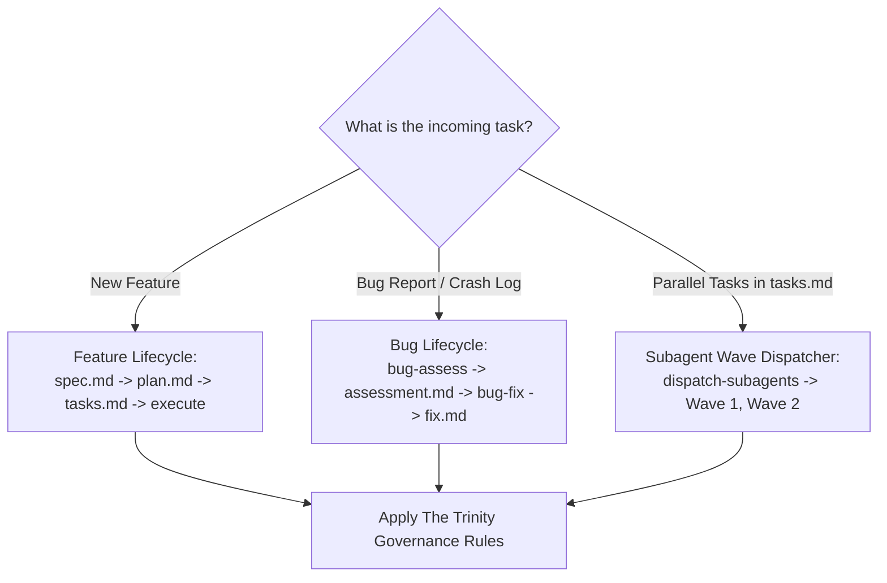
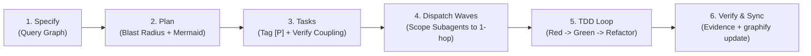
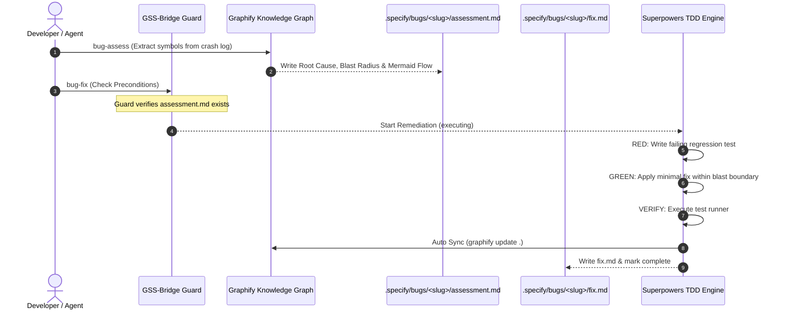

# GSS-Bridge: Graphify + Spec-Kit + Superpowers

GSS-Bridge is the multi-agent engineering protocol uniting **Spec-Kit** (Governance & Requirements Truth), **Graphify** (Codebase & Topology Truth), and **Superpowers** (Execution & Quality Discipline) across both feature development and bug triage lifecycles.

```
                           ┌──────────────────────────────┐
                           │      Spec-Kit (Governance)   │
                           │   specs/<feature>/ · bugs/   │
                           │   spec.md · plan.md · tasks  │
                           └──────────────┬───────────────┘
                                          │
                  ┌───────────────────────┴───────────────────────┐
                  ▼                                               ▼
   ┌──────────────────────────────┐                ┌──────────────────────────────┐
   │     Graphify (Context)       │◄──────────────►│    Superpowers (Discipline)  │
   │  graphify-out/graph.json     │   Scoping &    │  TDD · Subagents · Debugging │
   │  query · explain · path      │   Traceability │  Verification · Code Review  │
   │  blast-radius · update       │                │  bug-fix · systematic-debug  │
   └──────────────────────────────┘                └──────────────────────────────┘
```

---

## When to Use



### Use When
- Developing new features in a repository governed by Spec-Kit (`.specify/`) and Superpowers.
- Triaging an incoming bug report, stack trace, or GitHub issue URL where call chains and blast radius must be verified before modifying code.
- Remedying a bug where strict Test-Driven Development (writing a failing test first) and verification evidence are required.
- Planning architecture in `plan.md` and needing component blast radius analysis with Mermaid call graphs.
- Partitioning parallel tasks `[P]` in `tasks.md` into decoupled subagent waves.
- The user or prompt invokes `/gss-bridge`, `/speckit-gss-bridge-execute`, `$gss-bridge`, `/speckit.gss-bridge.bug-assess`, or `/speckit.gss-bridge.bug-fix`.

### When NOT to Use
- Quick, one-line scratchpad edits with zero architectural dependencies or side effects.
- Repositories without Spec-Kit governance where unverified ad-hoc coding is explicitly desired.

---

## The Trinity Protocol: Three Sources of Truth & Discipline

| Dimension | Pillar | Responsibility | Core Mandate |
|---|---|---|---|
| **Governance & Contracts** | **Spec-Kit** | Single Source of Truth for Requirements, Plans & Bug Contracts | Features MUST live in `specs/<feature>/` (`spec.md`, `plan.md`, `tasks.md`). Bugs MUST live in `.specify/bugs/<slug>/` (`assessment.md`, `fix.md`). Never create disconnected plans in `docs/plans/`. |
| **Codebase & Topology** | **Graphify** | Single Source of Truth for Architecture, Call Flows & Coupling | Always query `graphify-out/graph.json` (`query`, `explain`, `path`) before `grep`/`find`. Calculate blast radius with Mermaid diagrams, detect task coupling, and auto-sync (`graphify update .`). |
| **Execution Standard** | **Superpowers** | Execution, TDD & Verification Discipline | Enforce Red-Green-Refactor TDD, Graphify-scoped subagent dispatch, graph-path systematic debugging, and verification evidence before completing tasks. |

---

## 1. Feature Lifecycle (Spec-Kit + Graphify + Superpowers)



1. **Specification (`spec.md`)**:
   Query domain concepts in the knowledge graph before declaring requirements:
   ```bash
   graphify query "How does <subsystem> work?"
   ```
2. **Planning (`plan.md`) & Blast Radius Analysis**:
   For every modified component, calculate blast radius and generate a Mermaid diagram:
   ```powershell
   .\.specify\extensions\gss-bridge\scripts\powershell\graphify-blast-radius.ps1 -Node "AuthService"
   ```
   Embed the output into `plan.md` under `## Blast Radius & Architecture Context`.
   **PROHIBITION**: Never invoke `superpowers:writing-plans` to generate external files in `docs/plans/`. Record all TDD steps directly in `plan.md`.
3. **Tasks Breakdown (`tasks.md`)**:
   Tasks must follow canonical `- [ ] T001 <description>`.
   Tag tasks with `[P]` only when they can safely execute in parallel without coupling.
4. **Subagent Wave Dispatching**:
   Run the wave dispatcher to partition `[P]` tasks into non-colliding waves:
   ```powershell
   .\.specify\extensions\gss-bridge\scripts\powershell\dispatch-subagents.ps1
   ```
   Scope each subagent strictly to the 1-hop/2-hop files identified by Graphify.
5. **Execution Discipline (TDD)**:
   - **RED**: Write failing test first.
   - **GREEN**: Write minimal code to pass.
   - **REFACTOR**: Improve design while preserving invariants.
6. **Completion & Auto Graphify Sync**:
   Verify test runner evidence before marking `- [x] T###`. Upon completing implementation, `update-handoff` automatically synchronizes the graph (`graphify update .`).

---

## 2. Bug Lifecycle: GSS-Bug Protocol

Native Spec-Kit bug commands (`speckit-bug-assess` and `speckit-bug-fix`) historically operated without Graphify topology context or Superpowers TDD discipline. GSS-Bridge bridges this gap.



### A. Bug Assessment (`speckit.gss-bridge.bug-assess`)
- **Input**: Bug description, error stack trace, or log file.
- **Action**:
  1. Identifies suspect components from error trace against `graphify-out/graph.json`.
  2. Computes 1-hop callers, 2-hop dependents, and blast radius risk level.
  3. Generates Mermaid call graph into `.specify/bugs/<slug>/assessment.md`.
  4. Defines strict TDD preconditions: a failing regression test case MUST be written before editing code.
- **Command**:
  ```powershell
  .\.specify\extensions\gss-bridge\scripts\powershell\bug-assess.ps1 -Slug "login-crash" -Symptom "NullReferenceException at AuthService.validateToken" -Actor <actor>
  ```

### B. Bug Fix (`speckit.gss-bridge.bug-fix`)
- **Precondition Check**: Guard denies `speckit.bug.fix` if `assessment.md` does not exist.
- **TDD Red-Green-Refactor**:
  1. Write a minimal regression test reproducing the failure. Confirm it fails (RED).
  2. Apply the minimal bug fix within the blast radius boundary (GREEN).
  3. Confirm regression test and test suite pass (REFACTOR).
- **Completion & Sync**:
  1. Run verification commands and record actual output.
  2. Trigger automatic graph synchronization (`graphify update .`).
  3. Generate `.specify/bugs/<slug>/fix.md`.
  4. Transition handoff state to `complete`.
- **Command**:
  ```powershell
  # Start remediation
  .\.specify\extensions\gss-bridge\scripts\powershell\bug-fix.ps1 -Slug "login-crash" -Actor <actor>

  # Complete remediation with verification evidence
  .\.specify\extensions\gss-bridge\scripts\powershell\bug-fix.ps1 -Slug "login-crash" -Complete -RegressionTest "tests/test-login.ps1" -VerificationEvidence "PASS: All 24 tests passed" -Actor <actor>
  ```

---

## 3. Parallel Subagent Wave Dispatcher

When executing multiple tasks tagged with `[P]` in `tasks.md`:
- Tasks targeting components within 2 hops in `graph.json` are **coupled** and cannot run in parallel.
- Tasks targeting disconnected or $>2$ hop components are **independent** and execute concurrently.
- The wave dispatcher groups tasks into sequential waves of concurrent subagents:

```powershell
.\.specify\extensions\gss-bridge\scripts\powershell\dispatch-subagents.ps1 -Actor <actor>
```

```bash
bash .specify/extensions/gss-bridge/scripts/bash/dispatch-subagents.sh --actor <actor>
```

**Subagent Scoping Rule**:
Provide each subagent with ONLY the primary component and its immediate 1-hop interface files. Never dump the entire repository into a subagent.

---

## 4. Multi-Agent Concurrency Guard

When multiple coding agents (e.g. Claude Code, Codex, Antigravity) collaborate on the same repository:
- `guard-command` inspects `.specify/gss-handoff.json` for active `artifact_owner` and `status`.
- If Agent A is executing a task affecting `ComponentA`, and Agent B attempts to execute on a coupled `ComponentB`, GSS-Bridge alerts of a concurrency collision risk.
- Edits to `.specify/memory/constitution.md` are strictly blocked during active implementation.

---

## Quick Reference & Boundary Rules

| Phase / Action | Allowed Operations | Prohibited Red Flags |
|---|---|---|
| **Specification** | `/speckit-specify`, `graphify query` on domain concepts. | Proposing new models without querying existing entities in graph. |
| **Planning** | `graphify-blast-radius` with Mermaid, embedding TDD matrices into `plan.md`. | Creating external plan files in `docs/plans/`. |
| **Tasks** | Tagging `[P]` after `dispatch-subagents` or coupling check. | Marking `[P]` without verifying $\ge 2$ hop independence. |
| **Bug Assessment** | `bug-assess.ps1` to extract call chains and blast radius into `assessment.md`. | Blind guessing or grep-only triage without graph topology. |
| **Bug Fix** | `bug-fix.ps1` with TDD reproduction test first (Red $\rightarrow$ Green). | Direct code patching without `assessment.md` or without writing a test. |
| **Completion** | Verification evidence, `graphify update .`, code review. | Marking `- [x] T###` or completing bug fix without test execution evidence. |

---

## Rationalization Table

| Excuse | Reality | Mandated Action |
|---|---|---|
| *"I can diagnose this bug by reading the file directly."* | Stack traces only show symptoms. Graphify reveals the full caller chain and transitive blast radius. | Run `/speckit.gss-bridge.bug-assess` first. |
| *"I'll fix the bug first, then add a test."* | Tests written after code are biased toward passing and miss regression edge cases. | Write a failing regression test (RED) before touching code. |
| *"I can run all [P] tasks at once."* | Tasks on coupled components produce merge conflicts and broken state. | Run `dispatch-subagents` to partition into independent waves. |
| *"I'll create the implementation plan in `docs/plans/`."* | Violates Spec-Kit as the single source of truth for design documentation. | Write TDD matrices directly into `specs/<feature>/plan.md`. |
| *"I don't need to update the graph after fixing."* | Stale knowledge graphs deceive future queries and lead to architectural drift. | Run `graphify update .` upon completion. |

---

## CLI & Script Reference

```powershell
# Check Bridge status and system readiness
.\.specify\extensions\gss-bridge\scripts\powershell\bridge-status.ps1 -Readiness -Actor <actor>

# Calculate Blast Radius and Mermaid Diagram
.\.specify\extensions\gss-bridge\scripts\powershell\graphify-blast-radius.ps1 -Node "AuthService" -Mermaid

# Verify coupling between two components
.\.specify\extensions\gss-bridge\scripts\powershell\graphify-blast-radius.ps1 -CheckCoupling -NodeA "OrderService" -NodeB "PaymentService"

# Dispatch parallel subagents into waves
.\.specify\extensions\gss-bridge\scripts\powershell\dispatch-subagents.ps1 -Actor <actor>

# Triage bug with Graphify
.\.specify\extensions\gss-bridge\scripts\powershell\bug-assess.ps1 -Slug "login-crash" -Symptom "Error trace" -Actor <actor>

# Remediate bug with Superpowers TDD
.\.specify\extensions\gss-bridge\scripts\powershell\bug-fix.ps1 -Slug "login-crash" -Actor <actor>

# Complete bug fix with verification evidence
.\.specify\extensions\gss-bridge\scripts\powershell\bug-fix.ps1 -Slug "login-crash" -Complete -RegressionTest "tests/repro.ps1" -VerificationEvidence "PASS" -Actor <actor>
```
