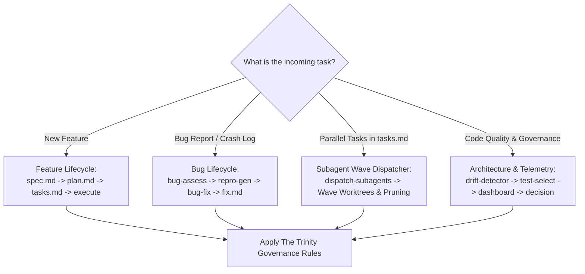
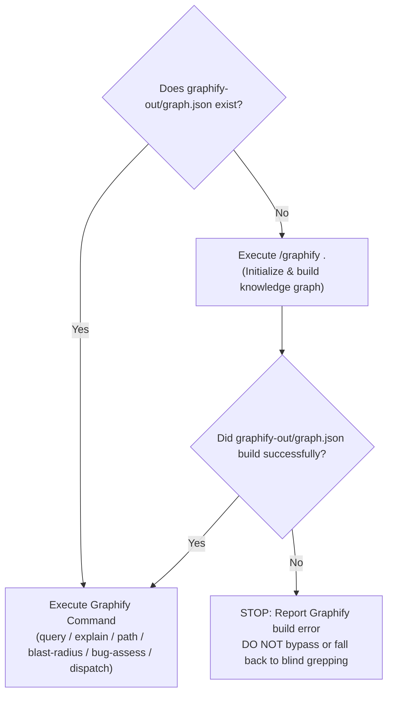
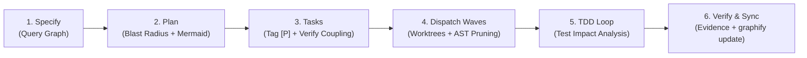
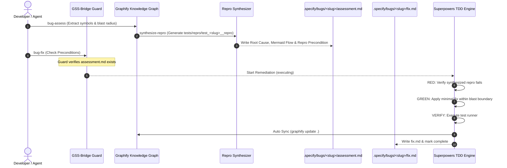
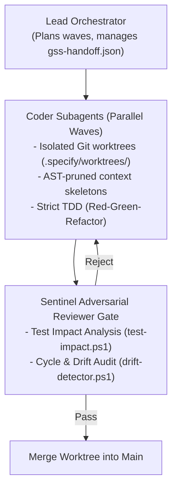

# GSS-Bridge: Graphify + Spec-Kit + Superpowers

GSS-Bridge is the multi-agent engineering protocol uniting **Spec-Kit** (Governance & Requirements Truth), **Graphify** (Codebase & Topology Truth), and **Superpowers** (Execution & Quality Discipline) across both feature development and bug triage lifecycles.

```
                           ┌──────────────────────────────┐
                           │      Spec-Kit (Governance)   │
                           │   specs/<feature>/ · bugs/   │
                           │   spec.md · plan.md · tasks  │
                           └──────────────┬───────────────┘
                                          │
                  ┌───────────────────────┴───────────────────────┐
                  ▼                                               ▼
   ┌──────────────────────────────┐                ┌──────────────────────────────┐
   │     Graphify (Context)       │◄──────────────►│    Superpowers (Discipline)  │
   │  graphify-out/graph.json     │   Scoping &    │  TDD · Subagents · Debugging │
   │  query · explain · path      │   Traceability │  Verification · Code Review  │
   │  blast-radius · TIA · drift  │                │  bug-fix · repro-synthesis   │
   └──────────────────────────────┘                └──────────────────────────────┘
```

---

## When to Use



### Use When
- Developing new features in a repository governed by Spec-Kit (`.specify/`) and Superpowers.
- Triaging an incoming bug report, stack trace, or GitHub issue URL where call chains, blast radius, and auto-synthesized repro tests must be verified before modifying code.
- Remedying a bug where strict Test-Driven Development (writing a failing test first) and verification evidence are required.
- Planning architecture in `plan.md` and needing component blast radius analysis with Mermaid call graphs.
- Partitioning parallel tasks `[P]` in `tasks.md` into decoupled subagent waves, isolated git worktrees, or token-pruned AST skeletons.
- Selecting impacted tests (TIA) topologically linked to modified components within 1–2 graph hops.
- Auditing architectural drift, forbidden layer boundaries, or circular dependency cycles.
- Recording or querying cross-agent decisions in `.specify/agent-decisions.jsonl`.
- Generating an interactive HTML cockpit at `.specify/dashboard/index.html`.
- The user or prompt invokes `/gss-bridge`, `/speckit-gss-bridge-execute`, `$gss-bridge`, `/speckit-gss-bridge-bug-assess`, `/speckit-gss-bridge-bug-fix`, `/speckit-gss-bridge-dispatch`, or any bridge command.

### When NOT to Use
- Quick, one-line scratchpad edits with zero architectural dependencies or side effects.
- Repositories without Spec-Kit governance where unverified ad-hoc coding is explicitly desired.

---

## The Trinity Protocol: Three Sources of Truth & Discipline

| Dimension | Pillar | Responsibility | Core Mandate |
|---|---|---|---|
| **Governance & Contracts** | **Spec-Kit** | Single Source of Truth for Requirements, Plans & Bug Contracts | Features MUST live in `specs/<feature>/` (`spec.md`, `plan.md`, `tasks.md`). Bugs MUST live in `.specify/bugs/<slug>/` (`assessment.md`, `fix.md`). Never create disconnected plans in `docs/plans/`. |
| **Codebase & Topology** | **Graphify** | Single Source of Truth for Architecture, Call Flows & Coupling | Always query `graphify-out/graph.json` (`query`, `explain`, `path`) before `grep`/`find`. **Graph Pre-requisite Mandate**: If `graphify-out/graph.json` does not exist, you MUST run `/graphify .` (or `graphify .`) to initialize and build the knowledge graph first before running any Graphify-dependent command; NEVER skip or bypass Graphify. Calculate blast radius with Mermaid diagrams, select impacted tests (TIA), detect architectural drift, and auto-sync (`graphify update .`). AI governance frameworks (`.specify/`, `.agents/`, `.claude/`, etc.) and Graphify engine outputs (`graphify-out/`, `raw/`, `.graphify*`) must be strictly excluded via `.graphifyignore`. |
| **Execution Standard** | **Superpowers** | Execution, TDD & Verification Discipline | Enforce Red-Green-Refactor TDD, Graphify-scoped subagent dispatch, worktree wave isolation, AST skeleton pruning, and verification evidence before completing tasks. |

---

### Mandatory Knowledge Graph Pre-requisite & Auto-Initialization



**The Iron Law of Graph Initialization:**
> **Violating the letter of the rules is violating the spirit of the rules.**
> If any command or workflow requires Graphify — including `graphify query`, `graphify explain`, `graphify path`, `graphify-blast-radius`, `speckit-gss-bridge-bug-assess`, `speckit-gss-bridge-dispatch`, `speckit-gss-bridge-test-select`, `speckit-gss-bridge-drift`, or feature planning in `plan.md` — and `graphify-out/graph.json` has not yet been generated:
> 
> **You MUST execute `/graphify .` (or `graphify .`) to initialize the knowledge graph FIRST.**
> 
> **STRICT PROHIBITIONS**:
> - NEVER skip Graphify analysis because `graphify-out/graph.json` is missing.
> - NEVER fall back to raw file reading, blind grepping, or guessing when the graph is missing.
> - NEVER emit or accept an ungrounded bug assessment or plan stating "Graphify context not available" without initializing the graph.
> - NEVER proceed with task wave dispatching without graph distance analysis.

---

## 1. Feature Lifecycle (Spec-Kit + Graphify + Superpowers)



1. **Specification (`spec.md`)**:
   Query domain concepts in the knowledge graph before declaring requirements:
   ```bash
   graphify query "How does <subsystem> work?"
   ```
2. **Planning (`plan.md`) & Blast Radius Analysis**:
   For every modified component, calculate blast radius and generate a Mermaid diagram:
   ```powershell
   .\.specify\extensions\gss-bridge\scripts\powershell\graphify-blast-radius.ps1 -Node "AuthService"
   ```
   Embed the output into `plan.md` under `## Blast Radius & Architecture Context`.
   **PROHIBITION**: Never invoke `superpowers:writing-plans` to generate external files in `docs/plans/`. Record all TDD steps directly in `plan.md`.
3. **Tasks Breakdown (`tasks.md`)**:
   Tasks must follow canonical `- [ ] T001 <description>`.
   Tag tasks with `[P]` only when they can safely execute in parallel without coupling ($d \ge 3$ in graph).
4. **Subagent Wave Dispatching & Worktrees**:
   Run the wave dispatcher to partition `[P]` tasks into non-colliding waves and prune prompt tokens:
   ```powershell
   .\.specify\extensions\gss-bridge\scripts\powershell\dispatch-subagents.ps1 -PruneContext -Actor <actor>
   ```
   Scope each subagent strictly to the 1-hop/2-hop files identified by Graphify.
5. **Execution Discipline (TDD & TIA)**:
   - Identify targeted test suites via Test Impact Analysis (`test-impact.ps1`).
   - **RED**: Write failing test first.
   - **GREEN**: Write minimal code to pass.
   - **REFACTOR**: Improve design while preserving invariants.
6. **Completion & Auto Graphify Sync**:
   Verify test runner evidence before marking `- [x] T###`. Upon completing implementation, `update-handoff` automatically synchronizes the graph (`graphify update .`).

---

## 2. Bug Lifecycle: GSS-Bug Protocol

Native Spec-Kit bug commands (`speckit-bug-assess` and `speckit-bug-fix`) operate with Graphify topology context, automated repro test synthesis, and Superpowers TDD discipline.



### A. Bug Assessment (`speckit-gss-bridge-bug-assess`)
- **Input**: Bug description, error stack trace, or log file.
- **Action**:
  1. Identifies suspect components from error trace against `graphify-out/graph.json`.
  2. Computes 1-hop callers, 2-hop dependents, and blast radius risk level.
  3. Synthesizes a minimal failing repro test harness in `tests/repro/` via `-GenerateRepro`.
  4. Generates Mermaid call graph into `.specify/bugs/<slug>/assessment.md`.
  5. Defines strict TDD preconditions: verify initial reproduction test failure (RED) before touching code.
- **Command**:
  ```powershell
  .\.specify\extensions\gss-bridge\scripts\powershell\bug-assess.ps1 -Slug "login-crash" -Symptom "NullReferenceException at AuthService.validateToken" -GenerateRepro -Actor <actor>
  ```

### B. Bug Fix (`speckit-gss-bridge-bug-fix`)
- **Precondition Check**: Guard denies `speckit.bug.fix` if `assessment.md` does not exist.
- **TDD Red-Green-Refactor**:
  1. Run the auto-synthesized test case reproducing the failure. Confirm it fails (RED).
  2. Apply the minimal bug fix within the blast radius boundary (GREEN).
  3. Confirm reproduction test and test suite pass (REFACTOR).
- **Completion & Sync**:
  1. Run verification commands and record actual output.
  2. Trigger automatic graph synchronization (`graphify update .`).
  3. Generate `.specify/bugs/<slug>/fix.md`.
  4. Transition handoff state to `complete`.
- **Command**:
  ```powershell
  # Start remediation
  .\.specify\extensions\gss-bridge\scripts\powershell\bug-fix.ps1 -Slug "login-crash" -Actor <actor>

  # Complete remediation with verification evidence
  .\.specify\extensions\gss-bridge\scripts\powershell\bug-fix.ps1 -Slug "login-crash" -Complete -RegressionTest "tests/repro/test_login-crash__repro.ps1" -VerificationEvidence "PASS: All tests passed" -Actor <actor>
  ```

---

## 3. Autonomous Multi-Agent Teamwork (GSS-Teamwork Protocol)

For complex campaigns and large refactoring tasks, GSS-Bridge provides an autonomous multi-agent teamwork architecture (integrating with Google Antigravity `/teamwork` and multi-agent swarms):



### Teamwork Roster
1. **Lead Orchestrator**: Maintains global contract truth from `spec.md`/`plan.md`, tracks lifecycle state, and coordinates waves.
2. **Coder Subagents**: Independent implementers assigned to non-colliding components ($d \ge 3$), working in isolated worktrees (`wave-worktree.ps1`).
3. **Sentinel Reviewer**: Independent adversarial gate verifying each wave before merge.

```powershell
# Generate autonomous teamwork plan with JSON output
.\.specify\extensions\gss-bridge\scripts\powershell\teamwork-plan.ps1 -Json

# Generate human-readable multi-agent roster and verification commands
.\.specify\extensions\gss-bridge\scripts\powershell\teamwork-plan.ps1
```

## 4. Parallel Subagent Waves & Worktree Isolation

When executing multiple tasks tagged with `[P]` in `tasks.md`:
- Tasks targeting components within 2 hops in `graph.json` are **coupled** and cannot run in parallel.
- Tasks targeting disconnected or $>2$ hop components are **independent** and execute concurrently in waves.
- **Git Worktree Isolation**: Subagents can run in isolated worktrees (`.specify/worktrees/<name>`) on dedicated branches (`gss-worktree/<name>`), eliminating git lock conflicts and dirty working trees.
- **Context Pruning**: Subagent prompts are pruned to AST skeletons, stripping function bodies and saving 70–80% of prompt tokens.

### The Iron Law of Automated Subagent Wave Dispatch
> **Violating the letter of the rules is violating the spirit of the rules.**
> When executing implementation tasks via `/gss-bridge` or `/speckit-gss-bridge-execute`:
> If `tasks.md` contains tasks tagged `[P]`:
> **The agent MUST run `dispatch-subagents.ps1 -Json` (or `.sh --json`) and MUST dispatch all tasks in each wave simultaneously using the runtime's subagent facility (`invoke_subagent` for Antigravity with `Model: 'inherit'`, `TypeName: 'self'`, `Prompt: task.subagent_prompt`).**
>
> **STRICT PROHIBITIONS**:
> - NEVER execute `[P]` tasks sequentially or inline in the parent session when subagent facilities exist.
> - NEVER skip wave dispatching when `[P]` tasks are present.
> - NEVER compose subagent prompts from scratch when `dispatch-subagents.ps1 -Json` provides pre-scoped `subagent_prompt` payloads.

```powershell
# Dispatch waves with AST skeleton pruning and JSON output
.\.specify\extensions\gss-bridge\scripts\powershell\dispatch-subagents.ps1 -PruneContext -Json

# Create an isolated wave worktree
.\.specify\extensions\gss-bridge\scripts\powershell\wave-worktree.ps1 -Action create -Name "wave-1-auth"
```

---

## 5. Advanced Architecture & Telemetry Tools

### A. Graph-Guided Test Impact Analysis (TIA)
Identifies all test files and suites within 1–2 hops of modified components or git changes:
```powershell
.\.specify\extensions\gss-bridge\scripts\powershell\test-impact.ps1 -DetectChanged -Json
```

### B. Architectural Drift & Cycle Auditor
Audits knowledge graph against layer boundaries (`.specify/memory/architecture-rules.json`) and detects circular dependency cycles (Tarjan's SCC):
```powershell
.\.specify\extensions\gss-bridge\scripts\powershell\drift-detector.ps1 -FailOnCycles
```

### C. Cross-Agent Reasoning & Decision Journal
Maintains a shared ledger of architectural choices, trade-offs, and hypotheses across agents in `.specify/agent-decisions.jsonl`:
```powershell
.\.specify\extensions\gss-bridge\scripts\powershell\log-decision.ps1 -Decision "Adopt AST skeleton pruning" -Rationale "Saves 70-80% token load" -Topic "performance" -Actor antigravity
```

### D. Interactive Visual Dashboard
Generates a standalone, zero-dependency dark-mode HTML cockpit at `.specify/dashboard/index.html`:
```powershell
.\.specify\extensions\gss-bridge\scripts\powershell\generate-dashboard.ps1 -Open
```

---

## 6. Structural File Formatting & Line Ending Discipline (CRLF)

In multi-agent environments spanning disparate execution runtimes (PowerShell on Windows, Git Bash, macOS zsh, Linux bash, and Python subprocesses), mixed or bare line endings (`\n` LF or `\r` CR) cause parse discrepancies, hash mismatches, corrupted script shebangs, and broken test assertions.

### The Universal Line Ending & Portability Rule
- **Mandate**: All structural and project files (`.md`, `.yml`, `.yaml`, `.json`, `.jsonl`, `.ps1`, `.py`, manifests, templates, and config files) MUST strictly be written and persisted with **CRLF (`\r\n`)** line endings.
- **POSIX Shell Scripts**: All shell scripts (`*.sh`) MUST strictly use **LF (`\n`)** line endings without carriage returns (`\r`) to ensure execution compatibility on Linux and macOS shells.
- **Enforcement**:
  - Repository `.gitattributes` mandates `* text=auto eol=crlf` and `*.sh text eol=lf`.
  - Test suites (`test-release-powershell.ps1` and `test-release-package.sh`) assert CRLF on structural assets and zero-CR on shell scripts.
  - Agents must normalize buffer contents accordingly before writing to disk.

---

## Quick Reference & Boundary Rules

| Phase / Action | Allowed Operations | Prohibited Red Flags |
|---|---|---|
| **Specification** | `/speckit-specify`, `graphify query` on domain concepts. | Proposing new models without querying existing entities in graph. |
| **Graph Initialization** | Running `/graphify .` whenever `graphify-out/graph.json` is missing before graph-dependent commands. | Skipping Graphify or falling back to manual grep/reading because graph.json is not yet created. |
| **Planning** | `graphify-blast-radius` with Mermaid, embedding TDD matrices into `plan.md`. | Creating external plan files in `docs/plans/`. |
| **Tasks** | Tagging `[P]` after `dispatch-subagents` or coupling check. | Marking `[P]` without verifying $\ge 2$ hop independence. |
| **Bug Assessment** | `bug-assess.ps1 -GenerateRepro` to synthesize repro harness and extract blast radius. | Blind guessing or grep-only triage without graph topology. |
| **Bug Fix** | `bug-fix.ps1` with TDD reproduction test first (Red $\rightarrow$ Green). | Direct code patching without `assessment.md` or without writing a test. |
| **Context Scoping** | `ast-skeleton.ps1` to strip function bodies for subagent prompts. | Dumping 2,000+ line raw source files into subagent prompts. |
| **Test Execution** | `test-impact.ps1` to selectively run tests affected within 2 hops. | Running entire slow test suites during every micro-refactor. |
| **Architecture Audit** | `drift-detector.ps1` to verify clean layering and zero cycles. | Merging code that introduces circular module dependencies. |
| **Cross-Agent Memory** | `log-decision.ps1` to record choices in `.specify/agent-decisions.jsonl`. | Refactoring without checking past agent trade-offs and rationale. |
| **File Formatting** | Writing and saving all structural files strictly with CRLF (`\r\n`). | Creating or saving files with bare LF (`\n`) or bare CR (`\r`). |
| **Completion** | Verification evidence, `graphify update .`, dashboard generation. | Marking `- [x] T###` or completing bug fix without test execution evidence. |

---

## Rationalization Table

| Excuse | Reality | Mandated Action |
|---|---|---|
| *"graphify-out/graph.json does not exist yet, so I will skip Graphify analysis and use grep or read files directly."* | Skipping Graphify violates Pillar 2 of the Trinity Protocol. Without graph topology, you are guessing callers, callees, and coupling blindly. | Stop immediately. Run `/graphify .` to initialize `graphify-out/graph.json`, then execute the Graphify command. |
| *"Building the graph takes time; I'll diagnose the bug or plan the feature first and build the graph later."* | Diagnosing bugs and planning architectures requires ground-truth topology from the start. Post-hoc graphs cannot fix flawed architectural assumptions. | Execute `/graphify .` first before diagnosing or planning. |
| *"The bug-assess script noted that graph context was not available, so I will continue with manual triage."* | Bug assessment without Graphify omits blast radius, Mermaid call flows, and caller boundaries. | Initialize the graph via `/graphify .`, re-run `bug-assess`, and produce a complete assessment. |
| *"I can diagnose this bug by reading the file directly."* | Stack traces only show symptoms. Graphify reveals the full caller chain and transitive blast radius. | Run `/speckit-gss-bridge-bug-assess` first. |
| *"I'll fix the bug first, then add a test."* | Tests written after code are biased toward passing and miss regression edge cases. | Run with `-GenerateRepro` and verify RED before touching code. |
| *"I can run all [P] tasks at once in the same working tree."* | Concurrent edits produce git index locks and state collisions. | Use `dispatch-subagents` and `wave-worktree`. |
| *"I must send all source files into the subagent prompt."* | Subagents only need signatures and interfaces; bodies waste 70–80% of tokens. | Use `ast-skeleton.ps1` / `dispatch -PruneContext`. |
| *"I need to run the entire 10-minute test suite on every change."* | Slow feedback halts TDD flow. Only tests linked within 1–2 hops are impacted. | Run `test-impact.ps1` during iteration; full suite before commit. |
| *"I don't need to record why I chose this library/architecture."* | The next agent (Claude, Codex, or Gemini) will lack context and may undo your work. | Record in `.specify/agent-decisions.jsonl` via `log-decision`. |
| *"I can implement these [P] tasks directly in the main session faster without subagents."* | Inline execution creates context pollution, ignores Graphify file scoping, and risks cross-task coupling. | Run `dispatch-subagents.ps1 -Json` and invoke `invoke_subagent` in parallel for each wave. |
| *"Writing prompts for subagents takes too many tokens."* | `dispatch-subagents.ps1 -Json` generates ready-to-run `subagent_prompt` payloads with AST context and TDD rules. | Pass `task.subagent_prompt` directly to `invoke_subagent`. |
| *"I'll create the implementation plan in `docs/plans/`."* | Violates Spec-Kit as the single source of truth for design documentation. | Write TDD matrices directly into `specs/<feature>/plan.md`. |
| *"I don't need to update the graph after fixing."* | Stale knowledge graphs deceive future queries and lead to architectural drift. | Run `graphify update .` upon completion. |
| *"It's just line endings, Git or the OS will handle LF/CRLF conversion automatically."* | In multi-agent environments spanning Windows, POSIX, and diverse toolchains (PowerShell, Git Bash, Python), mixed or bare LF/CR line endings corrupt test assertions, AST parsers, script shebangs, and cross-agent handoffs. | Enforce strict CRLF (`\r\n`) across all structural files (`.md`, `.yml`, `.yaml`, `.json`, `.jsonl`, `.ps1`, `.sh`, `.py`, manifests, templates). |
| *"Bash scripts can use CRLF on Linux/macOS."* | POSIX bash on Linux and macOS treats `\r` as a command character, causing syntax errors (`set: pipefail\r: invalid option`, `$'
': command not found`). | Enforce strict LF (`\n`) for all `*.sh` scripts via `.gitattributes` while keeping all structural files CRLF. |

---

## Red Flags - STOP and Fix

- Skipping Graphify analysis because `graphify-out/graph.json` does not exist yet.
- Falling back to grep/find or manual code inspection when a Graphify-dependent command is requested.
- Accepting a degraded "(Graphify context not available)" output without running `/graphify .`.
- Writing, modifying, or saving structural files with bare LF (`\n`) or CR (`\r`).
- Relying on Git autocrlf or editor auto-formatting without verifying file bytes.
- Modifying code before writing a failing reproduction test (violating TDD).
- Creating ad-hoc plan files outside Spec-Kit governance in `docs/plans/`.
- Marking tasks `[P]` without checking topological graph distance ($d \ge 3$).
- Inlining or executing `[P]` tasks sequentially in the main session instead of dispatching subagents.
- Ignoring the `subagent_prompt` generated by `dispatch-subagents.ps1 -Json`.
- Marking tasks `- [x]` without executing test verification commands and capturing evidence.

---

## CLI & Script Reference

```powershell
# Check Bridge status and system readiness
.\.specify\extensions\gss-bridge\scripts\powershell\bridge-status.ps1 -Readiness -Actor <actor>

# Calculate Blast Radius and Mermaid Diagram
.\.specify\extensions\gss-bridge\scripts\powershell\graphify-blast-radius.ps1 -Node "AuthService" -Mermaid

# Verify coupling between two components
.\.specify\extensions\gss-bridge\scripts\powershell\graphify-blast-radius.ps1 -CheckCoupling -NodeA "OrderService" -NodeB "PaymentService"

# Dispatch parallel subagents into waves with AST pruning
.\.specify\extensions\gss-bridge\scripts\powershell\dispatch-subagents.ps1 -PruneContext -Actor <actor>

# Extract AST Skeleton to reduce tokens
.\.specify\extensions\gss-bridge\scripts\powershell\ast-skeleton.ps1 -Path "src/core.py"

# Select impacted tests based on Graphify topology
.\.specify\extensions\gss-bridge\scripts\powershell\test-impact.ps1 -Node "AuthService"

# Audit architectural drift and circular dependencies
.\.specify\extensions\gss-bridge\scripts\powershell\drift-detector.ps1 -FailOnCycles

# Triage bug with Graphify and auto-synthesize repro harness
.\.specify\extensions\gss-bridge\scripts\powershell\bug-assess.ps1 -Slug "login-crash" -Symptom "Error trace" -GenerateRepro -Actor <actor>

# Remediate bug with Superpowers TDD
.\.specify\extensions\gss-bridge\scripts\powershell\bug-fix.ps1 -Slug "login-crash" -Actor <actor>

# Complete bug fix with verification evidence
.\.specify\extensions\gss-bridge\scripts\powershell\bug-fix.ps1 -Slug "login-crash" -Complete -RegressionTest "tests/repro/test_login-crash__repro.ps1" -VerificationEvidence "PASS" -Actor <actor>

# Record and query cross-agent decisions
.\.specify\extensions\gss-bridge\scripts\powershell\log-decision.ps1 -Decision "Choice" -Rationale "Why" -Topic "arch"
.\.specify\extensions\gss-bridge\scripts\powershell\log-decision.ps1 -Query "Choice"

# Generate interactive HTML dashboard
.\.specify\extensions\gss-bridge\scripts\powershell\generate-dashboard.ps1 -Open

# Manage isolated git worktrees for subagents
.\.specify\extensions\gss-bridge\scripts\powershell\wave-worktree.ps1 -Action create -Name "wave-1"
.\.specify\extensions\gss-bridge\scripts\powershell\wave-worktree.ps1 -Action cleanup -Name "wave-1"
```
