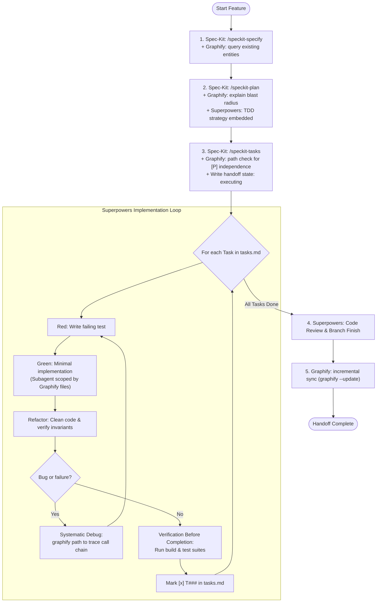

# GSS-Bridge: Graphify + Spec-Kit + Superpowers

GSS-Bridge is the orchestrator uniting **Spec-Kit** (Governance & Requirements Truth), **Graphify** (Codebase & Topology Truth), and **Superpowers** (Execution & Quality Discipline) into an integrated engineering workflow.

```
                           ┌──────────────────────────────┐
                           │      Spec-Kit (Governance)   │
                           │   specs/<feature>/           │
                           │   spec.md · plan.md · tasks  │
                           └──────────────┬───────────────┘
                                          │
                  ┌───────────────────────┴───────────────────────┐
                  ▼                                               ▼
   ┌──────────────────────────────┐                ┌──────────────────────────────┐
   │     Graphify (Context)       │◄──────────────►│    Superpowers (Discipline)  │
   │  graphify-out/graph.json     │   Scoping &    │  TDD · Subagents · Debugging │
   │  query · explain · path      │   Traceability │  Verification · Code Review  │
   └──────────────────────────────┘                └──────────────────────────────┘
```

---

## When to Use

### Use When
- You are developing features in a repository using Spec-Kit (`.specify/`) and Superpowers.
- A feature directory `specs/<feature>/` contains `spec.md`, `plan.md`, or `tasks.md`.
- You need to determine the architectural impact or blast radius of a change before writing code.
- You are executing tasks from `tasks.md` and need strict TDD (Test-Driven Development), subagent isolation, or systematic debugging.
- The user or workflow triggers `/speckit-gss-bridge-execute`, `/gss-bridge`, or `$gss-bridge`.

### When NOT to Use
- Quick, one-line scratchpad edits with no spec or architectural dependencies.
- Projects without Spec-Kit specifications or where ad-hoc unverified coding is explicitly requested.

---

## The Trinity: Three Sources of Truth & Discipline

| Dimension | Pillar | Responsibility | Core Mandate |
|---|---|---|---|
| **Governance & Docs** | **Spec-Kit** | Single Source of Truth for Requirements & Plans | All artifacts MUST live in `specs/<feature>/` (`spec.md`, `plan.md`, `tasks.md`). Never create separate plans in `docs/plans/`. |
| **Codebase & Topology** | **Graphify** | Single Source of Truth for Architecture & Dependencies | Always query `graphify-out/graph.json` (`query`, `explain`, `path`) before `grep`/`find`. Calculate blast radius and verify `[P]` task independence. |
| **Execution Standard** | **Superpowers** | Execution & Quality Discipline | Enforce Red-Green-Refactor TDD, Graphify-scoped subagent dispatch, graph-path systematic debugging, and verification evidence before completing tasks. |

---

## Quick Reference & Boundary Rules

| Phase | Allowed Operations | Denied Operations / Red Flags |
|---|---|---|
| **Specification** | `/speckit-specify`, `graphify query` on domain terms. | Blind guesswork without querying existing entities in graph. |
| **Planning** | `/speckit-plan`, `graphify explain` for blast radius, embedding TDD steps into `plan.md`. | Creating external plan files in `docs/plans/` (violates Spec-Kit truth). |
| **Tasks Breakdown** | `/speckit-tasks`, `graphify path` to verify independence of parallel tasks `[P]`. | Marking tasks `[P]` without proving zero dependency coupling in graph. |
| **Implementation** | `/gss-bridge`, `superpowers:test-driven-development`, Graphify-scoped subagent dispatch. | Running unprincipled `speckit.implement` without TDD or verification. |
| **Debugging** | `graphify path` to trace call graphs, `superpowers:systematic-debugging`. | Random trial-and-error edits without call path evidence. |
| **Completion** | `superpowers:verification-before-completion`, `graphify --update`. | Marking `[x] T###` without running tests or without updating graph. |

---

## The GSS-Bridge Lifecycle



---

## 1. Specification Phase (Spec-Kit + Graphify)

When generating specifications (`spec.md`):
1. **Query Existing Architecture**:
   Before proposing entities, endpoints, or data models, inspect the knowledge graph:
   ```bash
   graphify query "How does <subsystem> work?"
   ```
   Or via PowerShell:
   ```powershell
   graphify query "How does <subsystem> work?"
   ```
2. **Ground Requirements in Reality**:
   Ensure new features align with existing God Nodes and architectural clusters identified in `graphify-out/GRAPH_REPORT.md`.

---

## 2. Planning Phase & Blast Radius Analysis (Spec-Kit + Graphify + Superpowers)

When creating `plan.md`:
1. **Mandatory Blast Radius Section**:
   For every module, class, or service to be modified, run:
   ```bash
   graphify explain "<TargetNode>"
   ```
   Document the affected upstream callers and downstream dependencies directly in `plan.md` under:
   ```markdown
   ## Blast Radius & Architecture Context (Graphify)
   - **Target Node**: `AuthService`
   - **Direct Callers (1-hop)**: `UserController`, `TokenMiddleware`
   - **Transitive Impact (2-hop)**: `BillingService`, `NotificationWorker`
   - **Coupling Assessment**: Low / Moderate / High
   ```
2. **Embed TDD Strategy in `plan.md`**:
   **STRICT PROHIBITION**: Do NOT run Superpowers `writing-plans` to generate detached documents in `docs/plans/`.
   Instead, write the TDD testing strategy directly into `plan.md` (Test framework, test file locations, expected failing tests).

---

## 3. Tasks Breakdown & Parallelism Verification (Spec-Kit + Graphify)

When generating `tasks.md`:
1. **Task Numbering**: Every task must have a canonical identifier: `- [ ] T001 <task description>`.
2. **Parallel Task `[P]` Validation Gate**:
   Before tagging two tasks with `[P]` (indicating they can run concurrently via parallel subagents):
   - Identify the primary files/nodes modified by Task A (`NodeA`) and Task B (`NodeB`).
   - Run a coupling verification check:
     ```bash
     graphify path "NodeA" "NodeB"
     ```
   - **Rule**: If `graphify path` finds a direct dependency or shared mutable dependency within 2 hops, the tasks **CANNOT** be tagged `[P]`. They must be ordered sequentially to prevent race conditions and merge conflicts.
3. **Handoff Generation**:
   The `after_tasks` hook automatically generates `.specify/gss-handoff.json` (and `.specify/superpowers-handoff.json`) with status `executing`.

---

## 4. Execution Discipline (Superpowers + Graphify Scoping)

When implementing tasks (`/gss-bridge` or `speckit.gss-bridge.execute`):

### A. Subagent Scoping with Graphify
When using `subagent-driven-development` to dispatch subagents for independent tasks:
- **Do NOT** feed the subagent the entire repository or a wide directory tree.
- Extract the 1-hop and 2-hop file cluster from `graphify explain "<TargetComponent>"`.
- Provide the subagent **ONLY** the target files and immediate interfaces.
- *Result*: 50x–100x context token savings and zero hallucinatory hallucinations.

### B. Test-Driven Development (TDD)
For every implementation task:
1. **RED**: Write the failing test case first. Run test runner to confirm failure.
2. **GREEN**: Write minimal code to satisfy the test. Confirm test passes.
3. **REFACTOR**: Improve design while keeping tests green.

### C. Systematic Debugging with Graph Path
If a test fails unexpectedly or a regression occurs:
- **STOP**: Do NOT guess or edit files randomly.
- Run `graphify path "<Caller>" "<Callee>"` and `graphify explain "<FailingModule>"` to inspect call hierarchies, parameter handoffs, and edge confidence tags.
- Formulate a falsifiable hypothesis based on the graph topology before touching code.

### D. Verification Before Completion
Before marking any task checkbox `- [x] T###`:
- Run the actual build/test commands.
- Check actual test execution output.
- Never check off a task on assumptions or unverified promises.

---

## 5. Post-Execution, Review & Graph Synchronization

1. **Code Review**: Run `superpowers:requesting-code-review`.
2. **Branch Finishing**: Run `superpowers:finishing-a-development-branch`.
3. **Graphify Incremental Synchronization**:
   After code changes pass review, synchronize the knowledge graph:
   ```bash
   graphify --update
   ```
4. **Handoff Completion**:
   Transition handoff state to `complete`:
   ```powershell
   .\.specify\extensions\gss-bridge\scripts\powershell\update-handoff.ps1 -Status complete -Actor <actor>
   ```

---

## Rationalization Table

| Excuse | Reality | Mandated Action |
|---|---|---|
| *"I can just grep instead of using Graphify."* | Grep is blind to AST relationships, callers, and indirect dependencies. You will miss transitive blast radius. | Run `graphify query` or `graphify explain` first. |
| *"I'll create the implementation plan in `docs/plans/`."* | Violates Spec-Kit as the single source of documentation truth. Scatters project specs. | Write TDD plans directly into `specs/<feature>/plan.md`. |
| *"I can run these tasks in parallel `[P]` without checking."* | Unchecked parallel tasks on coupled modules cause merge collisions and test breakage. | Run `graphify path` between the task targets. If coupled, serialize them. |
| *"The subagent needs the whole repo for context."* | Dumping the repo burns context tokens and causes the subagent to lose focus or hallucinate. | Use `graphify explain` to scope the subagent strictly to affected files. |
| *"I'll write tests after the code is working."* | Tests written after code are biased to what the code does, not what it *should* do. Immediate passes prove nothing. | Write failing test first. Watch it fail. Then write code. |
| *"I don't need to run `graphify --update` after finishing."* | Outdated graphs deceive future queries and lead subsequent features into architectural errors. | Run `graphify --update` upon completing implementation. |

---

## Red Flags - STOP and Correct Immediately

- Creating any markdown file in `docs/plans/`.
- Marking `- [x] T###` without running the test runner command in the current session.
- Dispatching subagents with generic "read the entire repo" instructions.
- Marking tasks `[P]` when `graphify path` reports an active dependency edge between them.
- Modifying production code before a failing test exists.
- Modifying `.specify/memory/constitution.md` while a handoff status is `executing`.

---

## CLI & Script Reference

```powershell
# Check Bridge status and system readiness
.\.specify\extensions\gss-bridge\scripts\powershell\bridge-status.ps1 -Readiness -Actor <actor>

# Calculate Blast Radius for a component
.\.specify\extensions\gss-bridge\scripts\powershell\graphify-blast-radius.ps1 -Node "AuthService"

# Verify independence between two tasks/components for [P] tagging
.\.specify\extensions\gss-bridge\scripts\powershell\graphify-blast-radius.ps1 -CheckCoupling -NodeA "OrderService" -NodeB "PaymentService"

# Run guard check before action
.\.specify\extensions\gss-bridge\scripts\powershell\guard-command.ps1 -Action "speckit.implement" -Actor <actor>

# Transition handoff state
.\.specify\extensions\gss-bridge\scripts\powershell\update-handoff.ps1 -Status executing -FeatureDirectory "specs/001-my-feature" -Actor <actor>
```
