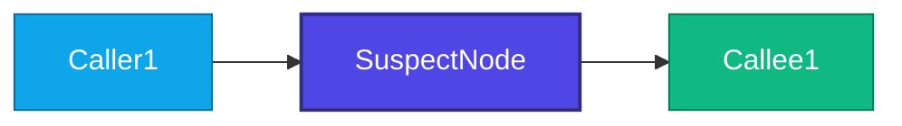

# Bug Assessment: [SLUG]

> **Status**: ASSESSED
> **Triage Agent**: [ACTOR]
> **Assessed At**: [TIMESTAMP]

## 1. Reported Symptom & Context
```text
[Paste error log, exception stack trace, or issue reproduction instructions]
```

## 2. Graphify Root Cause Candidates & Architecture Topology
- **Primary Suspect Component**: `[SuspectNode]`
- **Source Location**: `[path/to/file.ext] : [line:col]`
- **Direct Callers (1-hop)**: [Caller1, Caller2]
- **Direct Callees (1-hop)**: [Callee1, Callee2]
- **Transitive Impact (2-hop)**: [N] node(s)
- **Blast Radius Risk Assessment**: **[LOW / MEDIUM / HIGH]**

### Architecture Call Flow (Graphify)


## 3. Mandatory Superpowers TDD Preconditions
- [ ] **TDD Failing Test Required**: You MUST write a minimal reproducing test case in the test suite that FAILS (Red) reproducing the symptom before touching any implementation code.
- [ ] **Boundary Scoping**: Code modifications MUST be restricted to the immediate suspect component and directly coupled callers/callees identified above.

## 4. Next Step
Execute fix with Superpowers discipline: `/speckit.gss-bridge.bug-fix slug=[SLUG]`
