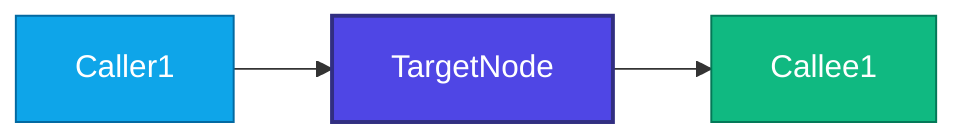

# Implementation Plan: [FEATURE_NAME]

## 1. Executive Summary
- **Feature ID**: [NNN-feature-name]
- **Goal**: [Brief description of what this feature achieves]
- **Target Completion**: [Target date / version]

## 2. Graphify Architecture & Blast Radius Analysis
> Ground all changes in codebase topology before writing code. Query `graphify-out/graph.json`.

### A. Affected Core Nodes
| Component / Node | File / Source Location | Role | Graphify Degree / Centrality |
|---|---|---|---|
| `[TargetNodeA]` | `[path/to/file.ext]` | `[Role]` | `[Degree]` |
| `[TargetNodeB]` | `[path/to/file.ext]` | `[Role]` | `[Degree]` |

### B. Blast Radius Analysis (`graphify explain "<TargetNode>"`)
- **Direct Callers (1-hop)**: [Components directly calling this module]
- **Direct Callees (1-hop)**: [Components called by this module]
- **Transitive Impact (2-hop)**: [Upstream/downstream systems affected]
- **Risk Assessment**: [Low / Medium / High] - [Mitigation strategy]

### C. Architecture Call Flow (Graphify Mermaid Diagram)
> Run `graphify-blast-radius.ps1 -Node "<TargetNode>" -Mermaid` to generate.

### D. Architectural Boundaries & Invariants
- Invariant 1: [Critical architectural invariant that must not be broken]
- Invariant 2: [Interface contract preservation]

## 3. Superpowers TDD Strategy
> All implementation plans follow Test-Driven Development (Red-Green-Refactor). No external `docs/plans/` files!

### Test Framework & Environments
- **Unit Test Runner**: [e.g., pytest, jest, dotnet test]
- **Integration Test Runner**: [e.g., playwright, testcontainers]
- **Test File Location**: `[tests/path/to/test_*.ext]`

### Red-Green-Refactor Test Matrix
| Requirement / Story | Test Case (Red Phase) | Expected Failure Mode | Minimal Implementation (Green Phase) |
|---|---|---|---|
| User Story 1 | `test_should_reject_invalid_token` | Assert token validation fails | Implement signature check |
| User Story 2 | `test_should_handle_concurrent_write` | Assert race condition detected | Add transaction lock |

## 4. Subagent Scoping & Wave Dispatch (Graphify Neighborhoods)
Run `/speckit.gss-bridge.dispatch` to automatically group parallel `[P]` tasks into waves:
- **Wave 1**: Scope Subagent 1 to `[file1, file2]`; Subagent 2 to `[file3, file4]` (Zero pairwise coupling)
- **Wave 2**: Scope to dependent tasks after Wave 1 passes verification

## 5. Verification Checklist Before Completion
- [ ] Unit tests pass with 100% success
- [ ] Integration tests pass
- [ ] No regressions in 2-hop blast radius callers
- [ ] Graphify incremental sync (`graphify --update`) executed
