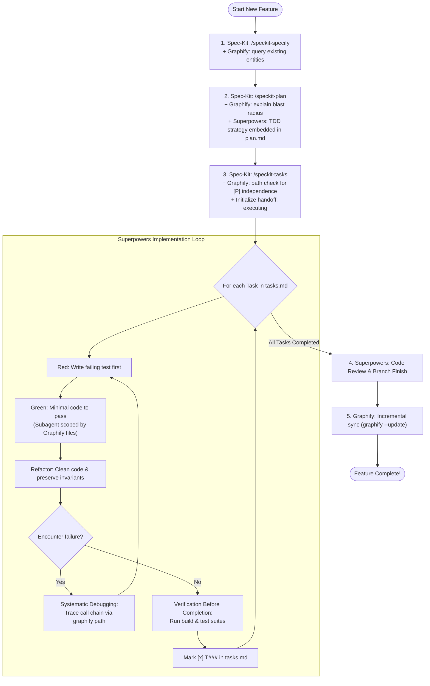

<p align="center">
  <h1 align="center">GSS-Bridge</h1>
  <p align="center">
    <strong>Graphify (Context) + Spec-Kit (Governance) + Superpowers (Discipline)</strong>
  </p>
  <p align="center">
    <em>Spec-Kit defines WHAT. Graphify reveals WHERE. Superpowers enforces HOW.</em>
  </p>
</p>

> [!NOTE]
> 🇻🇳 **Tiếng Việt**: Xem tài liệu bằng tiếng Việt tại [README.vi-VN.md](README.vi-VN.md).

---

## 🌟 Overview

**GSS-Bridge (Graphify-Speckit-Superpowers Bridge)** establishes the **Golden Triangle** architecture uniting three premier paradigms in AI-assisted software engineering:

```
                           ┌──────────────────────────────┐
                           │      Spec-Kit (Governance)   │
                           │   specs/<feature>/           │
                           │   spec.md · plan.md · tasks  │
                           └──────────────┬───────────────┘
                                          │
                  ┌───────────────────────┴───────────────────────┐
                  ▼                                               ▼
   ┌──────────────────────────────┐                ┌──────────────────────────────┐
   │     Graphify (Context)       │◄──────────────►│    Superpowers (Discipline)  │
   │  graphify-out/graph.json     │   Scoping &    │  TDD · Subagents · Debugging │
   │  query · explain · path      │   Traceability │  Verification · Code Review  │
   └──────────────────────────────┘                └──────────────────────────────┘
```

1. **Spec-Kit (Governance & Documentation Truth)**: Canonical requirements, architectural blueprints, and task manifests.
2. **Graphify (Context & Codebase Topology Truth)**: Persistent knowledge graph, blast radius calculation, parallel task independence verification, and subagent context scoping.
3. **Superpowers (Execution & Quality Discipline)**: Strict Test-Driven Development (TDD), isolated subagent execution, call-graph systematic debugging, and verified evidence before completion.

---

## ⚡ The Three Golden Rules

### 1. Documentation Source of Truth (Spec-Kit Governs)
- **Centralized Location**: All requirements (`spec.md`), implementation architectures (`plan.md`), and checklists (`tasks.md`) MUST reside strictly in `specs/<feature>/`.
- **No Fragmented Plans**: When Superpowers' `writing-plans` skill is active, agents are strictly forbidden from creating standalone files in `docs/plans/`. All TDD testing strategies and verification gates must be recorded directly into `plan.md` and `tasks.md`.
- **Execution Immutability**: Specifications cannot be altered while the handoff status is `executing`. Contract modifications require setting the handoff to `blocked` first.

### 2. Codebase Source of Truth (Graphify Governs)
- **Graph-First Navigation**: Always prefer `graphify query`, `graphify explain`, and `graphify path` on `graphify-out/graph.json` before resorting to `grep`, `find`, or whole-directory reads.
- **Blast Radius Analysis**: Before writing implementation code, run `graphify explain "<Node>"` to determine direct callers (1-hop) and transitive system impact (2-hop).
- **Parallel Task `[P]` Validation**: Run `graphify path "NodeA" "NodeB"` to verify that tasks marked `[P]` have zero close coupling or shared mutable state before running them concurrently.

### 3. Execution Standard (Superpowers Governs)
- **Test-Driven Development (TDD)**: Every code modification requires writing a failing test (RED) before writing minimal code to pass (GREEN), followed by clean refactoring (REFACTOR).
- **Subagent-Driven Development**: Independent `[P]` tasks are delegated to subagents. Each subagent is scoped ONLY to the files identified by Graphify's neighborhood (yielding 50x–100x token savings and preventing hallucinations).
- **Systematic Debugging**: When tests fail, trace the call chain via `graphify path` before proposing hypotheses or changing code. Never guess or try random edits.
- **Verification Before Completion**: Run real test suites and confirm passing output before marking `- [x] T###`.
- **Graph Synchronization**: Execute `graphify --update` upon completing implementation to refresh the knowledge graph for future development cycles.

---

## 🔄 Lifecycle Workflow



---

## 🚀 Quick Start

### 1. Installation

As a Spec-Kit Extension:
```bash
specify extension add gss-bridge --from ./dist/gss-bridge.zip
```

Or as an Agent Skill:
- **Claude Code**: Automatically recognized at `.claude/skills/gss-bridge/SKILL.md`
- **Codex / Antigravity / Gemini CLI**: Automatically recognized at `.agents/skills/gss-bridge/SKILL.md`

### 2. Feature Specification & Planning
```bash
# 1. Create specification (grounded in Graphify entities)
/speckit-specify 001-authentication-service

# 2. Clarify requirements
/speckit-clarify

# 3. Plan architecture + Blast Radius analysis
/speckit-plan

# 4. Break down tasks + Verify [P] task independence
/speckit-tasks
```

### 3. Implementation Execution
Activate the GSS-Bridge orchestrator:
- On Claude Code / Antigravity: `/gss-bridge` or `/speckit-gss-bridge-execute`
- On OpenAI Codex: `$gss-bridge` or `$speckit-gss-bridge-execute`

---

## 🛠️ Integrated CLI Tooling

| Script (PowerShell / Bash) | Description |
|---|---|
| `bridge-status.ps1` / `.sh` | Inspect handoff state, pending task counts, and system readiness. |
| `graphify-blast-radius.ps1` / `.sh` | Calculate component blast radius or verify coupling between tasks `[P]`. |
| `guard-command.ps1` / `.sh` | Enforce boundary guards (blocks unprincipled code, blocks detached plan files). |
| `update-handoff.ps1` / `.sh` | Transition handoff state (`ready`, `executing`, `blocked`, `complete`), snapshot, and audit. |
| `auto-archive-handoff.ps1` / `.sh` | Auto-archive completed handoffs before initiating new features. |

### CLI Examples

```powershell
# Run system readiness report
.\.specify\extensions\gss-bridge\scripts\powershell\bridge-status.ps1 -Readiness

# Calculate Blast Radius for AuthService
.\.specify\extensions\gss-bridge\scripts\powershell\graphify-blast-radius.ps1 -Node "AuthService"

# Verify if Task A (OrderService) and Task B (PaymentService) can run in parallel [P]
.\.specify\extensions\gss-bridge\scripts\powershell\graphify-blast-radius.ps1 -CheckCoupling -NodeA "OrderService" -NodeB "PaymentService"

# Transition state to executing
.\.specify\extensions\gss-bridge\scripts\powershell\update-handoff.ps1 -Status executing -FeatureDirectory "specs/001-auth-service" -Actor claude
```

---

## 📊 Positioning Matrix

| Criterion | Only `speckit.implement` | Only Superpowers | speckit-superpowers-bridge | **GSS-Bridge (This Architecture)** |
|---|---|---|---|---|
| **Documentation Truth** | `specs/` | Fragmented in `docs/plans/` | `specs/` | **`specs/` strictly centralized** |
| **Architectural Awareness** | None (manual grep) | None (blind search) | None | **Yes: Graphify Knowledge Graph** |
| **Blast Radius Calculation** | None | None | None | **Yes: `graphify explain`** |
| **Parallel Task `[P]` Check** | Guesswork | Guesswork | Guesswork | **Yes: `graphify path` coupling test** |
| **Subagent Scoping** | Entire repo dump | Wide context | Wide context | **1–2 hop neighborhood (50-100x savings)** |
| **TDD & Systematic Debug** | None (one-shot LLM) | TDD Red-Green | TDD Red-Green | **TDD + Call-graph path debugging** |
| **Post-Implementation Sync** | None | None | None | **Yes: Automatic `graphify --update`** |

---

## 🧪 Verification & Automated Testing

Run the full contractual verification suite:

```powershell
# On Windows PowerShell
pwsh -File tests/run-all.ps1

# On Linux / macOS Bash
bash tests/run-all.sh
```

---

## 📄 License

Released under the [MIT License](LICENSE).
Copyright © 2026 GSS-Bridge Contributors.
