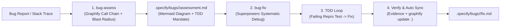

# GSS-Bridge: Graphify + Spec-Kit + Superpowers

<p align="center">
  
</p>

<p align="center">
  <strong>The Golden Triangle of AI-Driven Software Engineering: Spec-Kit Governance, Graphify Codebase Context, and Superpowers Execution Discipline.</strong>
</p>

<p align="center">
  <a href="https://github.com/maihcx/GSS-Bridge/actions"></a>
  <a href="https://github.com/maihcx/GSS-Bridge/releases/latest"></a>
  <a href="LICENSE"></a>
  <a href="https://github.com/maihcx/GSS-Bridge"></a>
  <a href="https://github.com/maihcx/GSS-Bridge"></a>
</p>

<p align="center">
  <a href="README.md"><strong>English</strong></a> •
  <a href="README.vi-VN.md"><strong>Tiếng Việt</strong></a>
</p>

---

## At a Glance

| Pillar | System | Responsibility | Key Mechanism |
|---|---|---|---|
| **Governance** | **Spec-Kit** | Requirements, contracts, tasks & bug triage single source of truth | `specs/<feature>/` (`spec.md`, `plan.md`, `tasks.md`), `.specify/bugs/<slug>/` (`assessment.md`, `fix.md`) |
| **Context** | **Graphify** | Codebase topology, AST relationships, blast radius & call chains | `graphify-out/graph.json` (`query`, `explain`, `path`, `blast-radius`, `update .`) |
| **Discipline** | **Superpowers** | Execution quality, subagent wave dispatch, TDD & verification | Red-Green-Refactor, `systematic-debugging`, `verification-before-completion`, `dispatch-subagents` |

---

## Why GSS-Bridge?

### The Problem
When AI coding agents (Claude Code, OpenAI Codex, Google Antigravity, Gemini CLI) implement features or fix bugs, they encounter three critical failure modes:
1. **Unprincipled Implementation (`speckit.implement`)**: Spec-Kit creates great specifications, but standard implementation is a single-shot execution with no TDD, no subagent isolation, and no verification gates.
2. **Context Blindness (Grep / Search Guesswork)**: Agents try to understand large codebases through grep, full-file dumps, or lexical search, missing AST call chains, callers, and transitive blast radius.
3. **Bug Lifecycle Gaps (`speckit-bug-assess` & `speckit-bug-fix`)**: Bug assessment previously searched files blindly without call graph tracing, and bug fixing patched code directly without writing reproducing tests first.

### The Solution: The Golden Triangle

```
                           ┌──────────────────────────────┐
                           │      Spec-Kit (Governance)   │
                           │   specs/<feature>/ · bugs/   │
                           │   spec.md · plan.md · tasks  │
                           └──────────────┬───────────────┘
                                          │
                  ┌───────────────────────┴───────────────────────┐
                  ▼                                               ▼
   ┌──────────────────────────────┐                ┌──────────────────────────────┐
   │     Graphify (Context)       │◄──────────────►│    Superpowers (Discipline)  │
   │  graphify-out/graph.json     │   Scoping &    │  TDD · Subagents · Debugging │
   │  query · explain · path      │   Traceability │  Verification · Code Review  │
   │  blast-radius · update       │                │  bug-fix · systematic-debug  │
   └──────────────────────────────┘                └──────────────────────────────┘
```

GSS-Bridge fuses all three into an airtight engineering loop:
* **Spec-Kit defines WHAT**: Requirements, contracts, tasks, and bug assessments.
* **Graphify reveals WHERE**: Invariant boundaries, blast radius, Mermaid call flows, and scoped subagent file lists.
* **Superpowers enforces HOW**: Failing tests before code, call-graph systematic debugging, and verified evidence before marking complete.

---

## Quick Start

```bash
# 1. Initialize a Spec-Kit project (or use existing)
specify init my-project --integration claude   # or --integration codex
cd my-project

# 2. Add GSS-Bridge
specify extension add gss-bridge \
  --from https://github.com/maihcx/GSS-Bridge/releases/latest/download/gss-bridge.zip

# 3. Index your codebase with Graphify
/graphify
```

---

## Core Lifecycles

### 1. Feature Lifecycle (The 7-Step Loop)

1. **Specify**: Run `/speckit-specify <feature-name>` (queries existing entities via `graphify query`).
2. **Clarify**: Run `/speckit-clarify` to resolve ambiguities.
3. **Plan**: Run `/speckit-plan` $\rightarrow$ calculates component blast radius and Mermaid call flow via `graphify explain` and embeds TDD test strategies into `plan.md`.
4. **Tasks**: Run `/speckit-tasks` $\rightarrow$ tags parallel tasks `[P]` after verifying coupling.
5. **Dispatch Waves**: Run `/speckit.gss-bridge.dispatch` to group `[P]` tasks into non-colliding execution waves with 1-hop file boundaries.
6. **Implement**: Run `/gss-bridge` (Claude Code / Antigravity) or `$gss-bridge` (Codex) $\rightarrow$ dispatches Graphify-scoped subagents, enforces TDD Red-Green-Refactor, systematically traces bugs, and verifies build/tests.
7. **Complete & Sync**: Verification passes $\rightarrow$ code review $\rightarrow$ `graphify update .` runs automatically $\rightarrow$ handoff transitions to `complete`.

### 2. Bug Lifecycle (GSS-Bug Protocol)



1. **Assess (`/speckit.gss-bridge.bug-assess`)**:
   - Parses error stack traces against `graphify-out/graph.json`.
   - Traces call paths, computes 1-hop callers and 2-hop blast radius.
   - Generates Mermaid diagram and TDD contract in `.specify/bugs/<slug>/assessment.md`.
2. **Fix (`/speckit.gss-bridge.bug-fix`)**:
   - Guard denies bug fix if `assessment.md` is missing.
   - Enforces `systematic-debugging` and `test-driven-development`: writes failing regression test (RED) before touching code.
   - Minimal code fix applied within blast boundary (GREEN).
   - Enforces `verification-before-completion`, automatically synchronizes the graph (`graphify update .`), and outputs `.specify/bugs/<slug>/fix.md`.

---

## 1.x Readiness and Support

| Target | Status | Evidence |
|---|---|---|
| **Linux bash** | Verified | Native Bash smoke suite plus release packaging gates (`tests/run-all.sh`). |
| **Windows PowerShell 5.1+** | Verified | Native PowerShell test suite (`tests/run-all.ps1`) and sandbox cycle. |
| **macOS bash** | Verified | Native POSIX path regression and smoke test gate. |
| **Claude Code** | Verified | Automatic skill pickup at `.claude/skills/gss-bridge/SKILL.md`. |
| **OpenAI Codex** | Verified | Automatic skill pickup at `.agents/skills/gss-bridge/SKILL.md`. |
| **Google Antigravity** | Verified | Native skill invocation `/gss-bridge` with subagent wave dispatching. |
| **Gemini CLI** | Verified | Shared handoff contract and command-line execution. |

Run the lightweight readiness check anytime:

```bash
bash .specify/extensions/gss-bridge/scripts/bash/bridge-status.sh --readiness
```

```powershell
.\.specify\extensions\gss-bridge\scripts\powershell\bridge-status.ps1 -Readiness
```

---

## Positioning Matrix

| Feature | Just `speckit.implement` | Just Superpowers | speckit-superpowers-bridge | **GSS-Bridge** |
|---|---|---|---|---|
| **Documentation Truth** | `specs/` | Fragmented in `docs/plans/` | `specs/` | **`specs/` & `.specify/bugs/` strictly canonical** |
| **AST / Topology Graph** | None (blind grep) | None (blind grep) | None (blind grep) | **Yes: `graphify-out/graph.json`** |
| **Blast Radius Calculation** | None | None | None | **Yes: `graphify explain` + Mermaid diagram** |
| **Parallel Task `[P]` Check** | Guesswork | Guesswork | Guesswork | **Yes: `graphify path` coupling check** |
| **Parallel Subagent Waves** | None | Manual dispatch | Manual dispatch | **Yes: Automated Wave Dispatcher (`dispatch-subagents`)** |
| **Bug Triage & Assessment** | Blind file search | Ad-hoc debugging | None | **Yes: Graph-driven call chain (`bug-assess`)** |
| **Bug Remediation & TDD** | Direct unverified patch | TDD Red-Green | TDD Red-Green | **Contract-governed TDD (`bug-fix`)** |
| **Subagent Scoping** | Entire repo dump | Wide directory tree | Wide directory tree | **1–2 hop AST neighborhood (50-100x savings)** |
| **Multi-Agent Collision Guard** | None | None | None | **Yes: Concurrent workspace conflict detection** |
| **Knowledge Graph Sync** | None | None | None | **Yes: Automatic `graphify update .`** |
| **Cross-Agent Support** | Partial | Partial | Claude + Codex | **Claude + Codex + Antigravity + Gemini** |

---

## Integrated CLI Tooling

GSS-Bridge ships dual-platform PowerShell 5.1+ and POSIX Bash scripts under `.specify/extensions/gss-bridge/scripts/`:

```powershell
# 1. Inspect bridge state & system readiness
.\.specify\extensions\gss-bridge\scripts\powershell\bridge-status.ps1 -Readiness

# 2. Calculate component blast radius with Mermaid diagram
.\.specify\extensions\gss-bridge\scripts\powershell\graphify-blast-radius.ps1 -Node "AuthService" -Mermaid

# 3. Check if two tasks/nodes can run in parallel [P]
.\.specify\extensions\gss-bridge\scripts\powershell\graphify-blast-radius.ps1 -CheckCoupling -NodeA "OrderService" -NodeB "PaymentService"

# 4. Dispatch parallel subagents into independent execution waves
.\.specify\extensions\gss-bridge\scripts\powershell\dispatch-subagents.ps1 -Actor claude

# 5. Triage an incoming bug report with Graphify
.\.specify\extensions\gss-bridge\scripts\powershell\bug-assess.ps1 -Slug "login-crash" -Symptom "NullReferenceException" -Actor antigravity

# 6. Execute bug remediation under Superpowers TDD
.\.specify\extensions\gss-bridge\scripts\powershell\bug-fix.ps1 -Slug "login-crash" -Complete -RegressionTest "tests/repro.ps1" -VerificationEvidence "PASS" -Actor antigravity
```

---

## Automated Verification Suite

Run the full local test suite on any platform:

```powershell
# Windows PowerShell (All 6 test suites)
pwsh -File tests/run-all.ps1

# Linux / macOS Bash (All 5 test suites)
bash tests/run-all.sh
```

Every release passes automated GitHub Actions quality gates on Linux, Windows, and macOS with release assets and SHA256 signatures published automatically.

---

## License

Released under the [MIT License](LICENSE).  
Copyright © 2026 GSS-Bridge Contributors.
