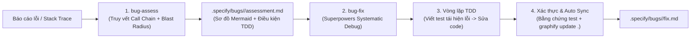

# GSS-Bridge: Graphify + Spec-Kit + Superpowers

<p align="center">
  
</p>

<p align="center">
  <strong>Tam Giác Vàng trong Kỹ Nghệ Phần Mềm Điều Khiển Bởi AI: Quản trị Spec-Kit, Ngữ cảnh Graphify, và Kỷ luật Thực thi Superpowers.</strong>
</p>

<p align="center">
  <a href="https://github.com/maihcx/GSS-Bridge/actions"></a>
  <a href="https://github.com/maihcx/GSS-Bridge/releases/latest"></a>
  <a href="LICENSE"></a>
  <a href="https://github.com/maihcx/GSS-Bridge"></a>
  <a href="https://github.com/maihcx/GSS-Bridge"></a>
</p>

<p align="center">
  <a href="README.md"><strong>English</strong></a> •
  <a href="README.vi-VN.md"><strong>Tiếng Việt</strong></a>
</p>

---

## Tổng quan nhanh

| Trụ cột | Hệ thống | Trách nhiệm cốt lõi | Cơ chế vận hành |
|---|---|---|---|
| **Quản trị (Governance)** | **Spec-Kit** | Nguồn sự thật duy nhất về yêu cầu, kế hoạch, task và quy trình xử lý lỗi | `specs/<feature>/` (`spec.md`, `plan.md`, `tasks.md`), `.specify/bugs/<slug>/` (`assessment.md`, `fix.md`) |
| **Ngữ cảnh (Context)** | **Graphify** | Nguồn sự thật về cấu trúc mã nguồn, quan hệ AST, phạm vi ảnh hưởng (Blast Radius) | `graphify-out/graph.json` (`query`, `explain`, `path`, `blast-radius`, `update .`) |
| **Kỷ luật (Discipline)** | **Superpowers** | Kỷ luật thực thi, điều phối subagent theo đợt, TDD & xác thực | Red-Green-Refactor, `systematic-debugging`, `verification-before-completion`, `dispatch-subagents` |

---

## Vì sao cần GSS-Bridge?

### Vấn đề thực tế
Khi các coding agent (Claude Code, OpenAI Codex, Google Antigravity, Gemini CLI) triển khai tính năng hoặc sửa lỗi, chúng thường vấp phải 3 sai lầm chí mạng:
1. **Thực thi thiếu nguyên tắc (`speckit.implement`)**: Spec-Kit lập đặc tả rất tốt, nhưng lệnh implement mặc định là code một lần (one-shot), không bắt buộc TDD, không cô lập subagent và không có bước xác thực kết quả.
2. **"Mù" ngữ cảnh khi dùng Grep**: Agent cố gắng hiểu kho mã nguồn lớn bằng grep hoặc đọc toàn bộ file mù quáng, bỏ sót luồng gọi hàm AST, các component phụ thuộc và phạm vi ảnh hưởng (Blast Radius).
3. **Quy trình xử lý lỗi sơ sài (`speckit-bug-assess` & `speckit-bug-fix`)**: Lệnh đánh giá lỗi cũ chỉ tìm file thủ công không theo đồ thị cuộc gọi; còn lệnh sửa lỗi lại cho agent sửa code ngay mà không viết test tái hiện lỗi trước.

### Giải pháp: Mô hình Tam Giác Vàng

```
                           ┌──────────────────────────────┐
                           │      Spec-Kit (Quản trị)     │
                           │   specs/<feature>/ · bugs/   │
                           │   spec.md · plan.md · tasks  │
                           └──────────────┬───────────────┘
                                          │
                  ┌───────────────────────┴───────────────────────┐
                  ▼                                               ▼
   ┌──────────────────────────────┐                ┌──────────────────────────────┐
   │     Graphify (Ngữ cảnh)      │◄──────────────►│    Superpowers (Kỷ luật)     │
   │  graphify-out/graph.json     │   Khoanh vùng  │  TDD · Subagents · Debugging │
   │  query · explain · path      │   & Truy vết   │  Xác thực · Code Review      │
   │  blast-radius · update       │                │  bug-fix · systematic-debug  │
   └──────────────────────────────┘                └──────────────────────────────┘
```

GSS-Bridge kết hợp cả ba thành một vòng lặp kỹ nghệ khép kín:
* **Spec-Kit xác định CÁI GÌ (WHAT)**: Yêu cầu, hợp đồng thiết kế, danh sách task và báo cáo đánh giá lỗi.
* **Graphify chỉ ra Ở ĐÂU (WHERE)**: Ranh giới bất biến, phạm vi ảnh hưởng (Blast Radius), sơ đồ gọi hàm Mermaid và danh sách file cô lập cho từng subagent.
* **Superpowers quy định NHƯ THẾ NÀO (HOW)**: Viết test thất bại trước khi viết code, truy vết lỗi có hệ thống theo đường đi đồ thị, và bắt buộc bằng chứng xác thực trước khi kết luận hoàn thành.

---

## Bắt đầu nhanh

```bash
# 1. Khởi tạo dự án Spec-Kit (hoặc dùng dự án hiện có)
specify init my-project --integration claude   # hoặc --integration codex
cd my-project

# 2. Thêm extension GSS-Bridge
specify extension add gss-bridge \
  --from https://github.com/maihcx/GSS-Bridge/releases/latest/download/gss-bridge.zip

# 3. Lập chỉ mục toàn bộ mã nguồn với Graphify
/graphify
```

---

## Hai quy trình vận hành cốt lõi

### 1. Quy trình Phát triển Tính năng (Vòng lặp 7 bước)

1. **Specify**: Chạy `/speckit-specify <tên-tính-năng>` (truy vấn thực thể hiện có qua `graphify query`).
2. **Clarify**: Chạy `/speckit-clarify` để giải quyết các điểm mơ hồ trong yêu cầu.
3. **Plan**: Chạy `/speckit-plan` $\rightarrow$ tính toán phạm vi ảnh hưởng và vẽ sơ đồ Mermaid qua `graphify explain`, ghi chiến lược TDD trực tiếp vào `plan.md`.
4. **Tasks**: Chạy `/speckit-tasks` $\rightarrow$ kiểm tra coupling trước khi gắn cờ song song `[P]`.
5. **Dispatch Waves**: Chạy `/speckit.gss-bridge.dispatch` để phân nhóm các task `[P]` thành các đợt (waves) không va chạm tài nguyên.
6. **Implement**: Chạy `/gss-bridge` (Claude / Antigravity) hoặc `$gss-bridge` (Codex) $\rightarrow$ điều phối subagent theo phạm vi 1-hop của Graphify, áp dụng TDD Red-Green-Refactor, truy vết bug theo đồ thị và xác thực build/test.
7. **Complete & Sync**: Xác thực đạt $\rightarrow$ review mã nguồn $\rightarrow$ tự động chạy `graphify update .` $\rightarrow$ chuyển trạng thái sang `complete`.

### 2. Quy trình Xử lý Lỗi (GSS-Bug Protocol)



1. **Đánh giá lỗi (`/speckit.gss-bridge.bug-assess`)**:
   - Trích xuất ký hiệu và hàm crash trong stack trace đối chiếu với `graphify-out/graph.json`.
   - Lập bản đồ cuộc gọi, tính toán 1-hop callers và 2-hop blast radius.
   - Xuất sơ đồ Mermaid và điều kiện TDD bắt buộc vào `.specify/bugs/<slug>/assessment.md`.
2. **Khắc phục lỗi (`/speckit.gss-bridge.bug-fix`)**:
   - Guard chặn đứng việc sửa code nếu chưa có `assessment.md`.
   - Áp dụng `systematic-debugging` và `test-driven-development`: BẮT BUỘC viết regression test đỏ (thất bại) trước khi chạm vào mã nguồn sản phẩm.
   - Sửa mã nguồn tối thiểu trong ranh giới blast radius để test xanh (thành công).
   - Xác thực toàn bộ test suite, tự động cập nhật đồ thị (`graphify update .`) và ghi báo cáo `.specify/bugs/<slug>/fix.md`.

---

## Bảng so sánh năng lực

| Tiêu chí | Chỉ dùng `speckit.implement` | Chỉ dùng Superpowers | speckit-superpowers-bridge | **GSS-Bridge** |
|---|---|---|---|---|
| **Nguồn sự thật tài liệu** | `specs/` | Rời rạc ở `docs/plans/` | `specs/` | **`specs/` & `.specify/bugs/` chuẩn tuyệt đối** |
| **Đồ thị kiến trúc AST** | Không có (grep mù) | Không có (grep mù) | Không có (grep mù) | **Có: `graphify-out/graph.json`** |
| **Tính toán Blast Radius** | Không có | Không có | Không có | **Có: `graphify explain` + Sơ đồ Mermaid** |
| **Kiểm tra task song song `[P]`** | Đoán mò | Đoán mò | Đoán mò | **Có: Kiểm tra coupling bằng `graphify path`** |
| **Phân đợt Subagent song song** | Không có | Thủ công | Thủ công | **Có: Bộ điều phối sóng tự động (`dispatch-subagents`)** |
| **Chẩn đoán & Đánh giá Bug** | Quét file mù quáng | Debug ngẫu hứng | Không có | **Có: Định vị call chain bằng Graph (`bug-assess`)** |
| **Khắc phục Bug theo TDD** | Vá trực tiếp không test | TDD Red-Green | TDD Red-Green | **Có: Buộc TDD theo hợp đồng (`bug-fix`)** |
| **Khoanh vùng Subagent** | Nạp cả repository | Cả thư mục lớn | Cả thư mục lớn | **1–2 hop AST (Tiết kiệm token 50-100 lần)** |
| **Cảnh báo xung đột đa Agent** | Không có | Không có | Không có | **Có: Phát hiện xung đột tài nguyên song song** |
| **Đồng bộ đồ thị tự động** | Không có | Không có | Không có | **Có: Tự động chạy `graphify update .`** |
| **Hỗ trợ đa nền tảng Agent** | Một phần | Một phần | Claude + Codex | **Claude + Codex + Antigravity + Gemini** |

---

## Hướng dẫn CLI & Scripts

GSS-Bridge cung cấp đầy đủ script PowerShell 5.1+ và POSIX Bash tại `.specify/extensions/gss-bridge/scripts/`:

```powershell
# 1. Kiểm tra trạng thái và độ sẵn sàng hệ thống
.\.specify\extensions\gss-bridge\scripts\powershell\bridge-status.ps1 -Readiness

# 2. Tính toán Blast Radius và vẽ sơ đồ Mermaid
.\.specify\extensions\gss-bridge\scripts\powershell\graphify-blast-radius.ps1 -Node "AuthService" -Mermaid

# 3. Kiểm tra tính độc lập giữa 2 component trước khi đánh dấu [P]
.\.specify\extensions\gss-bridge\scripts\powershell\graphify-blast-radius.ps1 -CheckCoupling -NodeA "OrderService" -NodeB "PaymentService"

# 4. Phân nhóm các task [P] thành các đợt subagent song song
.\.specify\extensions\gss-bridge\scripts\powershell\dispatch-subagents.ps1 -Actor claude

# 5. Chẩn đoán lỗi bằng đồ thị Graphify
.\.specify\extensions\gss-bridge\scripts\powershell\bug-assess.ps1 -Slug "login-crash" -Symptom "NullReferenceException" -Actor antigravity

# 6. Khắc phục lỗi và hoàn tất quy trình TDD
.\.specify\extensions\gss-bridge\scripts\powershell\bug-fix.ps1 -Slug "login-crash" -Complete -RegressionTest "tests/repro.ps1" -VerificationEvidence "PASS" -Actor antigravity
```

---

## Bộ kiểm thử tự động

Chạy toàn bộ test suites trên bất kỳ hệ điều hành nào:

```powershell
# Windows PowerShell (Toàn bộ 6 test suites)
pwsh -File tests/run-all.ps1

# Linux / macOS Bash (Toàn bộ 5 test suites)
bash tests/run-all.sh
```

Mọi bản phát hành đều được kiểm định tự động qua GitHub Actions trên cả 3 nền tảng Linux, Windows và macOS.

---

## Giấy phép (License)

Phát hành dưới [Giấy phép MIT](LICENSE).  
Bản quyền © 2026 GSS-Bridge Contributors.
