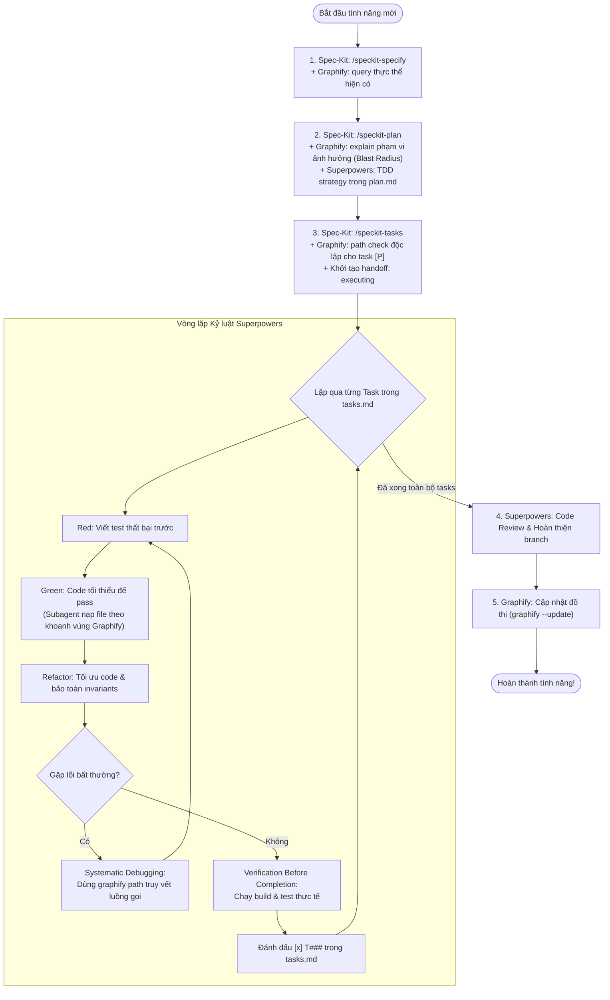

<p align="center">
  <h1 align="center">GSS-Bridge</h1>
  <p align="center">
    <strong>Graphify (Ngữ cảnh) + Spec-Kit (Quản trị) + Superpowers (Kỷ luật)</strong>
  </p>
  <p align="center">
    <em>Spec-Kit định nghĩa YÊU CẦU. Graphify thấu thị CẤU TRÚC. Superpowers thực thi KỶ LUẬT.</em>
  </p>
</p>

> [!NOTE]
> English Version: [README.md](README.md)

---

## 🌟 Tổng quan

**GSS-Bridge (Graphify-Speckit-Superpowers Bridge)** là kiến trúc tam giác vàng (The Golden Triangle) kết hợp sức mạnh tối ưu của 3 công cụ hàng đầu dành cho AI Coding Agents:

```
                           ┌──────────────────────────────┐
                           │      Spec-Kit (Quản trị)     │
                           │   specs/<feature>/           │
                           │   spec.md · plan.md · tasks  │
                           └──────────────┬───────────────┘
                                          │
                  ┌───────────────────────┴───────────────────────┐
                  ▼                                               ▼
   ┌──────────────────────────────┐                ┌──────────────────────────────┐
   │     Graphify (Ngữ cảnh)      │◄──────────────►│    Superpowers (Kỷ luật)     │
   │  graphify-out/graph.json     │  Khoanh vùng   │  TDD · Subagents · Debugging │
   │  query · explain · path      │  Truy vết lỗi  │  Verification · Code Review  │
   └──────────────────────────────┘                └──────────────────────────────┘
```

1. **Spec-Kit (Quản trị & Tài liệu)**: Thiết lập đặc tả yêu cầu, kế hoạch kiến trúc và danh sách công việc chuẩn hóa.
2. **Graphify (Ngữ cảnh & Cấu trúc mã nguồn)**: Đồ thị tri thức (Knowledge Graph) toàn diện, thấu thị phạm vi ảnh hưởng (blast radius), kiểm tra tính độc lập của tác vụ song song, khoanh vùng ngữ cảnh cho subagent.
3. **Superpowers (Kỷ luật & Tiêu chuẩn kỹ thuật)**: Triển khai nghiêm ngặt phương pháp TDD (Test-Driven Development), phân tách subagent độc lập, truy vết lỗi có hệ thống và xác nhận thực tế trước khi hoàn thành.

---

## ⚡ 3 Quy tắc phối hợp cốt lõi

### 1. Nguồn sự thật về Tài liệu (Spec-Kit làm chủ)
- **Tập trung hóa**: Mọi tài liệu đặc tả (`spec.md`), kế hoạch (`plan.md`) và danh sách công việc (`tasks.md`) BẮT BUỘC lưu theo cấu trúc chuẩn của Spec-Kit tại `specs/<feature>/`.
- **Cấm tạo file rời**: Khi kích hoạt kỹ năng `writing-plans` của Superpowers, **KHÔNG** tạo file rời rạc ở `docs/plans/`; hãy ghi trực tiếp các kịch bản kiểm thử TDD vào `plan.md` và `tasks.md` của Spec-Kit.
- **Tính bất biến khi thực thi**: Không sửa đổi hiến pháp hay đặc tả khi trạng thái handoff đang là `executing`. Nếu cần sửa đổi, phải chuyển trạng thái sang `blocked` trước.

### 2. Nguồn sự thật về Mã nguồn (Graphify làm chủ)
- **Truy vấn đồ thị trước tiên**: Luôn ưu tiên dùng `graphify query`, `graphify explain`, và `graphify path` trên `graphify-out/graph.json` trước khi dùng `grep`, `find` hoặc đọc toàn bộ thư mục.
- **Xác định phạm vi ảnh hưởng (Blast Radius)**: Trước khi lập kế hoạch code, dùng `graphify explain "<Node>"` để xác định các module gọi trực tiếp (1-hop) và các thành phần liên đới (2-hop).
- **Kiểm chứng tác vụ song song `[P]`**: Dùng `graphify path "NodeA" "NodeB"` để chứng minh hai module hoàn toàn không có liên kết trực tiếp trước khi đánh dấu tag song song `[P]`.

### 3. Quy chuẩn Thực thi (Superpowers làm chủ)
- **Test-Driven Development (TDD)**: Bắt buộc viết test thất bại (RED) trước khi viết code tối thiểu để pass test (GREEN), sau đó tái cấu trúc (REFACTOR).
- **Subagent-Driven Development**: Phân tách subagent độc lập theo từng task `[P]`. Mỗi subagent CHỈ được nạp ngữ cảnh các file nằm trong bán kính đã được Graphify khoanh vùng (tiết kiệm token 50-100x và loại bỏ ảo giác).
- **Systematic Debugging**: Khi gặp lỗi hoặc regression, dùng `graphify path` để truy vết luồng gọi hàm trước khi đưa ra giả thuyết sửa lỗi. Tuyệt đối không sửa mò.
- **Verification Before Completion**: Chạy test runner thực tế và thu thập bằng chứng pass trước khi đánh dấu `[x]` vào `tasks.md`.
- **Đồng bộ hóa đồ thị**: Chạy `graphify --update` sau khi hoàn thành code để cập nhật Knowledge Graph cho các phiên làm việc tiếp theo.

---

## 🔄 Luồng hoạt động (Lifecycle Workflow)



---

## 🚀 Hướng dẫn nhanh (Quick Start)

### 1. Cài đặt vào dự án Spec-Kit

Nếu sử dụng Spec-Kit extension:
```bash
specify extension add gss-bridge --from ./dist/gss-bridge.zip
```

Hoặc sử dụng kỹ năng agent trực tiếp:
- **Claude Code**: Kỹ năng tự động nhận diện tại `.claude/skills/gss-bridge/SKILL.md`
- **Codex / Antigravity / Gemini CLI**: Kỹ năng tự động nhận diện tại `.agents/skills/gss-bridge/SKILL.md`

### 2. Khởi tạo và lập đặc tả tính năng
```bash
# 1. Tạo đặc tả (tham chiếu ngữ cảnh từ Graphify)
/speckit-specify 001-authentication-service

# 2. Làm rõ yêu cầu
/speckit-clarify

# 3. Lập kế hoạch + Phân tích Blast Radius
/speckit-plan

# 4. Phân rã công việc + Kiểm chứng độc lập cho task [P]
/speckit-tasks
```

### 3. Thực thi triển khai với GSS-Bridge
Kích hoạt trình điều phối:
- Trên Claude Code / Antigravity: `/gss-bridge` hoặc `/speckit-gss-bridge-execute`
- Trên OpenAI Codex: `$gss-bridge` hoặc `$speckit-gss-bridge-execute`

---

## 🛠️ Bộ công cụ CLI tích hợp (Scripts)

| Kịch bản (PowerShell / Bash) | Mô tả chức năng |
|---|---|
| `bridge-status.ps1` / `.sh` | Xem trạng thái handoff, task tồn đọng và kiểm tra readiness của hệ thống. |
| `graphify-blast-radius.ps1` / `.sh` | Phân tích phạm vi ảnh hưởng của 1 component hoặc kiểm tra coupling giữa 2 task `[P]`. |
| `guard-command.ps1` / `.sh` | Thực thi các quy tắc biên giới, chặn hành vi code không TDD và chặn tạo file kế hoạch rời. |
| `update-handoff.ps1` / `.sh` | Cập nhật trạng thái handoff (`ready`, `executing`, `blocked`, `complete`), snapshot và audit log. |
| `auto-archive-handoff.ps1` / `.sh` | Tự động lưu trữ (archive) handoff đã hoàn tất khi bắt đầu tính năng mới. |

### Ví dụ sử dụng CLI

```powershell
# Kiểm tra độ sẵn sàng của hệ thống (Readiness Report)
.\.specify\extensions\gss-bridge\scripts\powershell\bridge-status.ps1 -Readiness

# Phân tích Blast Radius của module AuthService
.\.specify\extensions\gss-bridge\scripts\powershell\graphify-blast-radius.ps1 -Node "AuthService"

# Kiểm tra xem Task A (OrderService) và Task B (PaymentService) có chạy song song [P] được không
.\.specify\extensions\gss-bridge\scripts\powershell\graphify-blast-radius.ps1 -CheckCoupling -NodeA "OrderService" -NodeB "PaymentService"

# Chuyển trạng thái sang executing
.\.specify\extensions\gss-bridge\scripts\powershell\update-handoff.ps1 -Status executing -FeatureDirectory "specs/001-auth-service" -Actor claude
```

---

## 📊 Bảng so sánh vị thế (Positioning)

| Tiêu chí | Chỉ dùng `speckit.implement` | Chỉ dùng Superpowers | speckit-superpowers-bridge | **GSS-Bridge (Kiến trúc này)** |
|---|---|---|---|---|
| **Nguồn sự thật tài liệu** | `specs/` | `docs/plans/` rời rạc | `specs/` | **`specs/` tập trung tuyệt đối** |
| **Nhận thức kiến trúc (AST)** | Không (phải grep/find) | Không (grep mò mẫm) | Không | **Có: Graphify Knowledge Graph** |
| **Phân tích Blast Radius** | Không | Không | Không | **Có: `graphify explain`** |
| **Kiểm chứng song song `[P]`** | Phán đoán cảm tính | Phán đoán cảm tính | Phán đoán cảm tính | **Có: `graphify path` kiểm tra coupling** |
| **Khoanh vùng Subagent** | Nạp cả codebase (tốn token) | Nạp rộng | Nạp rộng | **Khoanh vùng 1-2 hop (tiết kiệm 50-100x)** |
| **Kỷ luật TDD & Debug** | Không (LLM chạy 1 lần) | TDD Red-Green | TDD Red-Green | **TDD + Debugging theo call path** |
| **Đồng bộ hóa sau khi code** | Không | Không | Không | **Có: `graphify --update` tự động** |

---

## 🧪 Kiểm thử (Testing)

Chạy toàn bộ bộ test kiểm chứng hợp đồng của GSS-Bridge:

```powershell
# Trên Windows PowerShell
pwsh -File tests/run-all.ps1

# Trên Linux / macOS Bash
bash tests/run-all.sh
```

---

## 📄 Bản quyền (License)

Phát hành theo giấy phép [MIT License](LICENSE).
Bản quyền © 2026 GSS-Bridge Contributors.
