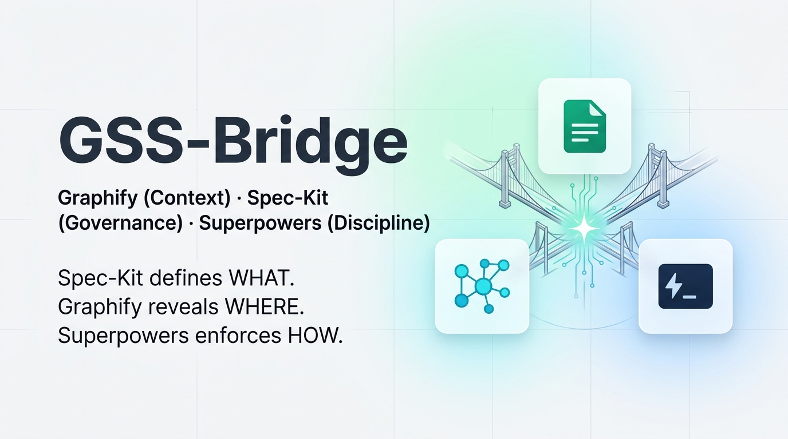

<p align="center">
  
</p>

<p align="center">
  <em>Spec-Kit định nghĩa YÊU CẦU. Graphify thấu thị CẤU TRÚC. Superpowers thực thi KỶ LUẬT.</em>
</p>

<p align="center">
  <a href="./LICENSE"></a>
  <a href="https://github.com/maihcx/GSS-Bridge/releases"></a>
  <a href="https://github.com/github/spec-kit"></a>
  <a href="https://github.com/safi-shamsi/graphify"></a>
  <a href="https://github.com/obra/superpowers"></a>
  <a href="https://github.com/github/spec-kit/blob/main/docs/community/extensions.md"></a>
</p>

# GSS-Bridge (Tiếng Việt)

> 🌐 **English**: See English documentation at [README.md](README.md).

**GSS-Bridge là giao thức tam giác vàng kết hợp đặc tả Spec-Kit, cấu trúc mã nguồn Graphify và kỷ luật thực thi Superpowers.** Spec-Kit giữ vai trò là nguồn sự thật duy nhất cho đặc tả yêu cầu và quản trị (`constitution` $\rightarrow$ `spec` $\rightarrow$ `plan` $\rightarrow$ `tasks`). Graphify đóng vai trò là la bàn kiến trúc (`graph.json` $\rightarrow$ phân tích phạm vi ảnh hưởng $\rightarrow$ kiểm tra coupling task song song $\rightarrow$ khoanh vùng subagent). Superpowers thực thi kỷ luật kỹ thuật khắt khe (TDD Red-Green-Refactor $\rightarrow$ systematic call-graph debugging $\rightarrow$ xác nhận thực tế trước khi hoàn thành $\rightarrow$ code review chuẩn mực).

Không daemon. Không dịch vụ chạy ngầm. Không database. Không workflow engine cồng kềnh. Không viết code vô căn cứ.

---

## ⚡ Điểm nổi bật (At a glance)

| Nếu bạn muốn... | GSS-Bridge mang lại cho bạn... |
|---|---|
| **Tài liệu Spec-Kit luôn là nguồn chuẩn mực** | Spec-Kit duy trì sở hữu `spec.md`, `plan.md`, và `tasks.md`. Tuyệt đối không tạo file rời rạc ở `docs/plans/`. |
| **Thấu thị kiến trúc mà không cần grep mò mẫm** | Đồ thị tri thức lưu tại `graphify-out/graph.json` truy vấn nhanh qua `query`, `explain`, và `path`. |
| **Biết trước phạm vi ảnh hưởng (Blast Radius)** | `graphify explain` tính toán các caller 1-hop và liên đới 2-hop ngay trong `plan.md`. |
| **Triệt tiêu xung đột cho task chạy song song `[P]`** | `graphify path` kiểm chứng tính độc lập giữa các tác vụ trước khi dispatch subagent. |
| **Subagent vận hành với chi phí token tối thiểu** | Ngữ cảnh được khoanh vùng nghiêm ngặt trong bán kính 1–2 hop AST (tiết kiệm 50x–100x token, chống ảo giác). |
| **Kỷ luật TDD nghiêm ngặt & Debug theo dấu vết** | Chu trình Red-Green-Refactor, gỡ lỗi theo đường đi hàm và bắt buộc bằng chứng pass test. |
| **Đa Agent phối hợp trên cùng một chuẩn** | Giao thức đồng nhất giữa Claude Code (`/gss-bridge`), OpenAI Codex (`$gss-bridge`), và Antigravity. |
| **Tự động đồng bộ hóa đồ thị tri thức** | Tự động chạy `graphify --update` sau khi hoàn thành để cập nhật Knowledge Graph cho các phiên sau. |
| **Hỗ trợ đầy đủ Windows, Linux và macOS** | Gói ZIP duy nhất hỗ trợ cả native Bash và PowerShell kèm kiểm thử CI/CD trên cả 3 nền tảng. |

Cài đặt bản phát hành ổn định:

```bash
specify extension add gss-bridge \
  --from https://github.com/maihcx/GSS-Bridge/releases/latest/download/gss-bridge.zip
```

---

## 🎯 Tại sao cần GSS-Bridge?

### Vấn đề của các công cụ đơn lẻ

1. **Chỉ dùng Spec-Kit**: Rất tốt trong việc tạo tài liệu đặc tả, nhưng lệnh `speckit.implement` mặc định chỉ là một lượt chạy LLM một lần, không có TDD, không phân tách subagent và không hiểu cấu trúc AST.
2. **Chỉ dùng Superpowers**: Kỷ luật thực thi rất tốt (TDD, subagents, review), nhưng lại tự tạo các file kế hoạch tạm bợ trong `docs/plans/`, làm mất đi tính quản trị lâu dài của dự án.
3. **Chỉ dùng Graphify**: Cung cấp đồ thị tri thức tuyệt vời, nhưng cần một quy chuẩn thực thi để hiện thực hóa các thông tin cấu trúc đó vào code.
4. **Các cầu nối cũ (Spec-Kit + Superpowers)**: Thực thi kỷ luật nhưng lại "mù" trước cấu trúc AST của mã nguồn, buộc agent phải dùng `grep` mò mẫm và đoán mò phạm vi ảnh hưởng.

### Giải pháp: Tam Giác Vàng (The Golden Triangle)

```
                           ┌──────────────────────────────┐
                           │      Spec-Kit (Quản trị)     │
                           │   specs/<feature>/           │
                           │   spec.md · plan.md · tasks  │
                           └──────────────┬───────────────┘
                                          │
                  ┌───────────────────────┴───────────────────────┐
                  ▼                                               ▼
   ┌──────────────────────────────┐                ┌──────────────────────────────┐
   │     Graphify (Ngữ cảnh)      │◄──────────────►│    Superpowers (Kỷ luật)     │
   │  graphify-out/graph.json     │   Khoanh vùng  │  TDD · Subagents · Debugging │
   │  query · explain · path      │   Truy vết lỗi │  Verification · Code Review  │
   └──────────────────────────────┘                └──────────────────────────────┘
```

GSS-Bridge kết hợp 3 công cụ thành một vòng lặp kỹ thuật khép kín:
* **Spec-Kit định nghĩa YÊU CẦU (WHAT)**: Hợp đồng, yêu cầu và task checklist trong `specs/<feature>/`.
* **Graphify thấu thị VỊ TRÍ (WHERE)**: Ranh giới bất biến, phạm vi ảnh hưởng (blast radius) và danh sách file cho subagent.
* **Superpowers thực thi KỶ LUẬT (HOW)**: Viết test thất bại trước khi viết code, truy vết lỗi theo đồ thị và xác nhận thực tế trước khi đánh dấu `[x]`.

---

## 🚀 Hướng dẫn nhanh (Quick Start)

```bash
# 1. Khởi tạo dự án Spec-Kit (hoặc dùng dự án hiện có)
specify init my-project --integration claude   # hoặc --integration codex
cd my-project

# 2. Thêm extension GSS-Bridge
specify extension add gss-bridge \
  --from https://github.com/maihcx/GSS-Bridge/releases/latest/download/gss-bridge.zip

# 3. Quét đồ thị tri thức mã nguồn bằng Graphify
/graphify
```

### Quy trình 7 bước phát triển một tính năng

1. **Specify**: Chạy `/speckit-specify <tên-tính-năng>` (tự động tra cứu các thực thể hiện có qua `graphify query`).
2. **Clarify**: Chạy `/speckit-clarify` để làm rõ các yêu cầu chưa rõ ràng.
3. **Plan**: Chạy `/speckit-plan` $\rightarrow$ tự động phân tích Blast Radius qua `graphify explain` và nhúng chiến lược TDD vào `plan.md`.
4. **Tasks**: Chạy `/speckit-tasks` $\rightarrow$ kiểm tra tính độc lập qua `graphify path` trước khi gán nhãn chạy song song `[P]`.
5. **Auto-Handoff**: Hook `after_tasks` tự động tạo `.specify/gss-handoff.json` với trạng thái `executing`.
6. **Implement**: Chạy `/gss-bridge` (Claude Code / Antigravity) hoặc `$gss-bridge` (Codex) $\rightarrow$ phân tách subagent theo file đã khoanh vùng, thực thi TDD Red-Green-Refactor, truy vết lỗi và chạy test xác nhận.
7. **Complete & Sync**: Test pass $\rightarrow$ code review $\rightarrow$ tự động chạy `graphify --update` $\rightarrow$ chuyển handoff sang `complete`.

---

## 🛠️ Bộ công cụ CLI tích hợp

GSS-Bridge cung cấp đầy đủ script cho cả PowerShell 5.1+ và POSIX Bash tại `.specify/extensions/gss-bridge/scripts/`:

```powershell
# 1. Xem trạng thái bridge & độ sẵn sàng của hệ thống
.\.specify\extensions\gss-bridge\scripts\powershell\bridge-status.ps1 -Readiness

# 2. Phân tích phạm vi ảnh hưởng (Blast Radius) của AuthService
.\.specify\extensions\gss-bridge\scripts\powershell\graphify-blast-radius.ps1 -Node "AuthService"

# 3. Kiểm tra xem 2 module có thể chạy song song [P] được không
.\.specify\extensions\gss-bridge\scripts\powershell\graphify-blast-radius.ps1 -CheckCoupling -NodeA "OrderService" -NodeB "PaymentService"

# 4. Cập nhật trạng thái handoff
.\.specify\extensions\gss-bridge\scripts\powershell\update-handoff.ps1 -Status executing -FeatureDirectory "specs/001-my-feature" -Actor claude

# 5. Đánh giá quy tắc bảo vệ biên giới (Guard)
.\.specify\extensions\gss-bridge\scripts\powershell\guard-command.ps1 -Action "speckit.implement" -Actor claude
```

---

## 🧪 Kiểm thử tự động (Verification Suite)

Chạy bộ kiểm thử hợp đồng trên môi trường cục bộ:

```powershell
# Trên Windows PowerShell
pwsh -File tests/run-all.ps1

# Trên Linux / macOS Bash
bash tests/run-all.sh
```

Mọi phiên bản phát hành đều phải vượt qua 100% các quality gate tự động trên GitHub Actions (Linux, Windows, macOS).

---

## 📄 Bản quyền (License)

Phát hành theo giấy phép [MIT License](LICENSE).  
Bản quyền © 2026 GSS-Bridge Contributors.
